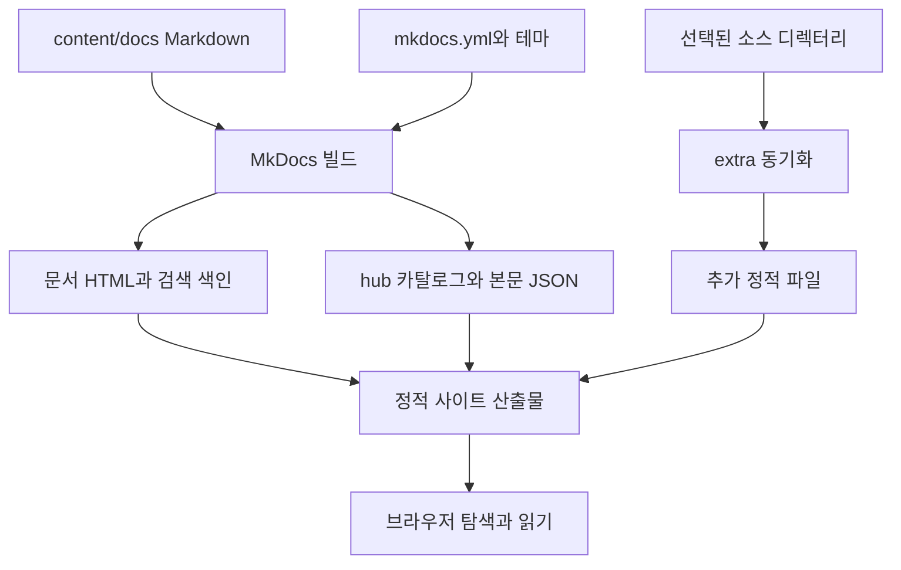

# 문서 사이트 출판 아키텍처

현재 사이트는 MkDocs가 만든 정적 문서와 탐색용 JSON을 브라우저에서 읽는다. 정본 경로를 정한 배경은 [저장소 레이아웃 ADR](../../adr/ADR-001-repo-layout.md)에 있고, 이 페이지는 실제 빌드 연결을 설명한다.

## 입력과 생성물

| 경로 | 역할과 변경 원칙 |
| --- | --- |
| `content/docs/` | 출판 문서와 실제로 로드되는 JS·CSS 입력 |
| `apps/docs-site/mkdocs.yml` | `docs_dir`, `site_dir`, 확장, hook, 탐색 메뉴 |
| `apps/docs-site/overrides/` | 현재 사이트 셸 템플릿 |
| `apps/docs-site/assets/` | 참조 자산 사본. 실제 입력과 혼동하지 않음 |
| `dist/site/` | 기본 빌드 결과. 원본 수정 대신 직접 고치면 다음 빌드에서 사라짐 |
| `hub/catalog.json` | 문서 메타데이터와 Compose 목록 |
| `hub/content/<document-id>.json` | 해당 문서의 렌더링 HTML, 목차, URL |
| `search/search_index.json` | 본문 검색용 색인 |
| `extra/` | 별도 스크립트로 복사하는 자료. 공개 검토가 별도로 필요 |

`hub_data.py`의 `document_id()`는 문서 상대 경로의 SHA256 앞 16자리로 ID를 만든다. 본문만 고치면 ID가 유지되지만 파일 경로를 바꾸면 ID가 달라진다. 브라우저에 저장한 책갈피·열린 문서가 새 ID로 자동 이전된다고 가정하지 않는다.

`on_page_content()`는 렌더링된 본문에서 설명과 목차를 수집하고 상대 링크를 문서 URL 기준으로 조정한다. `description`, `tags`, `intent`, `date`는 작성자가 제공할 수 있다. 읽기 시간은 단어 수로 계산한 추정치다. 파일 수정 시각이나 실제 독서 기록을 의미하지 않는다.

## 카탈로그가 포함하는 범위

카탈로그의 기대 집합은 MkDocs에 포함된 문서 파일이다. nav에 없는 파일도 포함될 수 있으므로 메뉴 삭제를 비공개 처리로 사용하면 안 된다. `on_post_build()`는 기대 집합과 수집한 본문 집합이 다르면 빌드를 실패시킨다. 부분 빌드 때문에 이 오류가 나면 전체 빌드로 확인한다.

Compose 카탈로그는 `infra/docker/stacks`의 파일을 읽어 서비스명·이미지·포트 등 선언된 메타데이터를 추출한다. 컨테이너를 실행하거나 현재 상태를 조회하지 않는다. `metadataStatus=parsed`는 YAML을 읽었다는 뜻이다. 실행 성공·건강 상태·가용성 판정이 아니다.

알고리즘 묶음의 `index.md`와 `README.md` 충돌은 `preserve_readme.py`가 처리한다. README를 `/algorithms/algorithm-architect/README/`에 별도로 출판한다. 이 예외를 일반적인 README 경로 규칙으로 확대하지 않는다.

## 운영상 결과

HTML·카탈로그·본문 JSON·검색 색인은 같은 빌드에서 배포해야 한다. 일부 파일만 교체하면 목록은 보이지만 본문이 없거나 검색 결과가 오래된 문서를 가리킬 수 있다. 산출물의 모든 파일이 공개될 수 있으므로 정적 사이트 자체에 비밀 저장이나 서버 인증을 맡길 수 없다.

근거: `apps/docs-site/mkdocs.yml`의 `docs_dir`, `hooks`, `extra_javascript`; `apps/docs-site/hooks/hub_data.py`의 `on_nav`, `on_page_content`, `collect_stacks`, `on_post_build`; `apps/docs-site/hooks/preserve_readme.py`의 `on_files`; `content/docs/javascripts/hub-app.js`의 `contentFor`, `ensureSearchIndex`.
