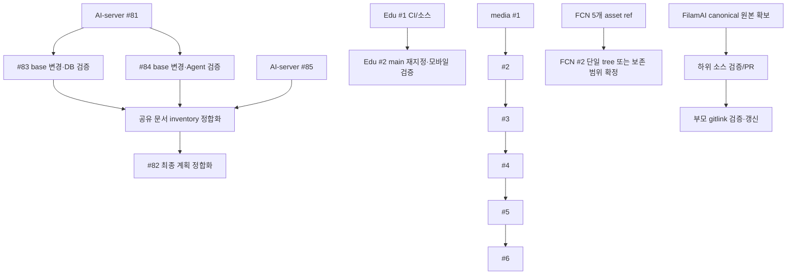

# Forgejo 전체 저장소 최신화 및 PR 병합 실행 계획

- 문서 유형: 실행 계획서 / 원격 작업 체크리스트 / 병합 및 복구 런북
- 기준 관측: **2026-09-26T14:50:36Z (Asia/Seoul 2026-09-26 23:50:36)** 및 같은 작성 세션의 후속 읽기
- 문서 버전: 1.0
- 총괄 상태: **계획 수립 완료, 실행·병합 미착수**
- 게시 대상: `admin_nodove/document`의 `plans/FORGEJO_REPOSITORY_SYNC_MERGE_EXECUTION_PLAN_20260926.md`
- 계획 소유: 중앙 실행 기록은 document, 구현·런타임·정본 상태는 각 저장소의 기존 문서
- 작성 범위: 저장소 64개, 기존 열린 PR 32개, PR 없는 저장소 48개
- 계수 기준: 이 계획서를 게시하기 위해 새로 만드는 문서 PR은 위 32개 기준선에 포함하지 않는다. 실행 재개 시 신규 PR을 포함해 다시 집계한다.

## 1. 목적과 이번 산출물

모든 확인 가능한 저장소에 대해 main에 반영되지 않은 변경, 오래된 PR 설명, 미검증 구현, 선행 PR 의존성, 별도 보존 브랜치와 누락 원본을 구분한다. 검증된 작업을 순서대로 병합하고, 병합할 수 없는 작업은 정확한 차단 조건·해소 행동·담당 역할·증거와 함께 남긴다.

이 문서는 “계획 업로드”, “검증된 소스 병합”, “운영 배포”, “기능 활성화”를 별도 단계로 정의한다. 문서 작성 중 기존 기능 PR을 병합하거나 저장소를 삭제·보관·강제 갱신하지 않았다. 요청된 실행 계획의 게이트는 검토와 실제 검증을 위한 조건이며, 이미 허용된 일상적인 읽기·분석·수정마다 별도 사용자 확인을 반복 요구하는 절차가 아니다.

### 1.1 최종 완료 조건

- [ ] 알려진 저장소 64개의 default ref, 전체 접근 가능한 branch, 열린 PR, 미러/원격 관계 및 정본 역할을 확인했다.
- [ ] 현재 열린 PR마다 MERGED 또는 근거 있는 BLOCKED/DEFERRED/DUPLICATE 상태와 다음 행동이 있다.
- [ ] 병합한 PR마다 검토한 HEAD/base, 테스트 환경·명령·종료 코드, 검사 결과, merge commit, 병합 후 main 검증이 연결돼 있다.
- [ ] PR이 없는 저장소도 미병합 branch/보존 ref·미게시 로컬 변경·외부 upstream 확인 범위를 명시했다.
- [ ] FCN 교차 ref 자산, FilamAI canonical 원본, IntelliAlgo 원본 복구와 같은 누락을 일반 PR 병합 완료와 혼동하지 않았다.
- [ ] 각 저장소의 정본 계획/상태 및 중앙 registry에 동일한 결과가 반영됐다.
- [ ] 접근 불가/전송 실패/환경 부재로 검증하지 못한 범위는 “전체 최신화 완료”에 포함하지 않았다.
- [ ] 배포가 수행된 경우만 별도 release/rollback 증거를 기록했다.

### 1.2 범위 밖의 자동 행동

운영 DB migration, 실제 메시지 발송·결제·유료 provider 호출, 실제 다운로드/작업 등록, 스토어 게시, 자동 업데이트 활성화, source history 재작성, 저장소 삭제/보관을 단순 PR 병합의 부수 작업으로 실행하지 않는다. 필요한 경우 기존 프로젝트의 실제 릴리스 절차와 사용자 요청 범위를 확인하여 별도 작업으로 기록한다. 특히 main push로 배포가 자동 실행되는 저장소는 병합 전 workflow와 효과를 확인한다.

## 2. 관측 범위와 수정된 인벤토리

### 2.1 초기 집계 정정

첫 분석에서는 `forgejo_repository_list`의 2페이지에서 얻은 `admin_nodove` 저장소 61개와 열린 PR 23개만 집계했다. 중앙 registry 원문을 추가로 읽고 다음 세 저장소를 `forgejo_repo_get`으로 직접 확인했다.

| 목록 API 밖에서 직접 확인한 저장소 | 열린 PR | 권한 관측 |
|---|---|---|
| [nodove/media-mcp](https://git.nodove.com/nodove/media-mcp) | #1–#6 | admin/push/pull=true |
| [nodove/forgejo_mcp](https://git.nodove.com/nodove/forgejo_mcp) | #18 | admin/push/pull=true |
| [nodove/Edu-connector](https://git.nodove.com/nodove/Edu-connector) | #1–#2 | admin/push/pull=true |

따라서 현재 **확인된** 범위는 64개 저장소, 16개 PR 보유 저장소, 32개 열린 PR이다. 목록 API가 왜 이 3개를 생략했는지는 아직 확인하지 않았다. 알려지지 않은 다른 owner의 저장소까지 모두 열거했다고 주장하지 않는다.

| 분류 | 수량 | 해석 |
|---|---:|---|
| 확인된 저장소 | 64 | 목록 61 + 직접 조회 3 |
| 열린 PR이 있는 저장소 | 16 | 이번 실행의 직접 PR 작업 대상 |
| 열린 PR | 32 | 이 문서의 작업 카드 32개 |
| mergeable=true | 24 | 서버 관측값이며 CI·리뷰 통과 증거가 아님 |
| Draft/WIP, mergeable=false | 8 | Draft 사실 확인. 실제 충돌 여부는 별도 확인 필요 |
| 열린 PR 없는 저장소 | 48 | 최신성 확정이 아니라 추가 branch 조사 대상 |

### 2.2 증거 등급

| 표시 | 의미 | 완료 판단에서의 사용 |
|---|---|---|
| OBSERVED | 이번 MCP 조회에서 확인한 metadata/ref/path/blob 또는 직접 읽은 파일 내용 | 해당 시점·반환 범위의 사실 |
| REPORTED | PR 본문 또는 기존 검증 보고서가 주장하는 테스트/과거 복구 결과 | 재실행 전에는 이번 검증 성공으로 사용하지 않음 |
| PLANNED | 앞으로 실행할 작업·검증·수락 조건 | 아직 구현/통과한 사실이 아님 |
| UNVERIFIED | 도구·권한·환경·원본 부족으로 확인하지 못함 | 병합/완료 판단의 명시적 제한 |
| BLOCKED | 특정 필수 조건을 충족하지 못하고 해소 행동이 정의됨 | 나머지 독립 작업은 계속 진행 |

### 2.3 도구의 현재 한계

이번 `forgejo_mcp_info` 응답은 version 2.2.0, stdio, 27 tools, source SHA256 `97f325609f54f357cdb9275e96767336babca4f277078e217dd2a4f532ee6149`였다. build_commit/build_time은 null이므로 소스 SHA256을 특정 Git commit과 임의로 동일시하지 않는다.

- branches/issues/reviews/comments/checks는 현재 연결에 노출되지 않는다.
- PR 세부 정보의 HEAD/base와 source identity를 관측 조건으로 file/diff 조회할 수 있다. 이는 원자적 잠금이나 영구 snapshot이 아니다.
- 파일/PR 페이지 coverage는 받은 응답 범위이며 upstream completeness는 unverified다.
- PR 본문이나 `mergeable=true`만으로 원격 required checks·승인 리뷰·branch protection 준수를 확정하지 않는다.
- PR 제목/본문 수정, Draft 해제, base 재지정도 현재 27개 도구에는 노출되지 않는다. 실행 시 실제 지원되는 인증된 UI/API/CLI 경로를 확인하고, 없으면 해당 쓰기 작업을 BLOCKED로 기록한다.
- Branch 조회 후보는 forgejo_mcp #18에 있으나 미병합이며 아직 이 연결에 배포되지 않았다. 이를 현재 도구처럼 호출할 수 있다고 계획하지 않는다.
- 비밀/금지 경로는 우회해서 가져오지 않는다. 허용된 검토 담당자의 근거 또는 정상 정책 변경 절차로 검토 공백을 해소한다.

### 2.4 현재 metadata와 읽은 파일 수의 차이

| PR | 서버 변경 파일 | MCP 반환 | 제외 |
|---|---:|---:|---:|
| blog #4 | 167 | 165 | 2 |
| community #1 | 502 | 501 | 1 |
| document #1 | 23 | 22 | 1 |
| Edu-connector #1 | 24 | 23 | 1 |

이 5개 제외 항목의 내용을 추정하지 않는다. 해당 PR의 전체 변경 검토 완료는 아직 입증하지 못했다.

## 3. 실행 상태·역할·기록 계약

### 3.1 상태 전이

`DISCOVERED → TRIAGED → NEEDS_UPDATE → VALIDATING → READY → MERGING → MERGED → VERIFIED`

- NEEDS_UPDATE 없이 VALIDATING으로 갈 수 있다.
- 어느 단계에서든 필수 조건이 부족하면 BLOCKED로 이동하고 재개 조건을 적는다.
- 다른 PR에 동일 변경이 완전히 포함됐다는 증거가 있으면 DUPLICATE_CANDIDATE로 분리한다. 제목 유사성만으로 닫지 않는다.
- 기존 PR로 해결되지 않는 원본 복구/후속 구현은 별도 작업 ID를 부여하고 DEFERRED 이유를 적는다.
- 문서 업로드 완료는 전체 작업의 VERIFIED가 아니다.

### 3.2 역할

| 역할 | 책임 | 산출물 |
|---|---|---|
| 실행 담당 | ref 수집, 작업 branch 격리, 수정·테스트·병합 요청, 결과 기록 | commit/명령/로그/작업 카드 |
| 검토 담당 | diff·도메인 불변식·테스트 증거 검토 | 검토 HEAD/base와 판정 |
| 저장소 담당 | 정본·요구 환경·운영 연결·자동 배포 동작 확인 | 경계 및 수락 기준 |
| 운영 담당 | 필요할 때 승인된 시험환경·배포·복구 절차 수행 | release/rollback evidence |

구체적인 사람이나 검토 승인을 임의 생성하지 않는다. 여러 역할을 같은 실행자가 수행할 때도 실제 검토 주체와 한계를 기록한다. 이 계획 자체는 병렬 에이전트 실행을 요구하지 않는다. 독립 저장소의 읽기/검증은 병렬화할 수 있으나 같은 저장소의 mutation과 병합은 순차 진행한다.

### 3.3 작업별 필수 기록

```yaml
task_id: PR-REPOSITORY-NUMBER
repository: owner/repo
pull_request: 0
state: DISCOVERED
observed_at_utc: null
base_ref: main
base_sha: null
head_ref: null
head_sha: null
source_identity: null
review:
  reviewer: null
  reviewed_head_sha: null
  reviewed_base_sha: null
  coverage: null
  exclusions: []
validation:
  environment: null
  commands: []
  exit_codes: []
  report_paths: []
  report_sha256: []
  required_checks: UNVERIFIED
  approvals: UNVERIFIED
blockers: []
next_action: null
merge:
  style: null
  submitted_head_commit_id: null
  result: NOT_ATTEMPTED
  merge_commit_sha: null
  main_sha_after: null
post_merge:
  checks: NOT_RUN
  registry_updated: false
deployment:
  state: NOT_REQUESTED_OR_NOT_RUN
  release_reference: null
```

로그에는 credential·토큰·개인자료 원문을 넣지 않는다. 테스트 결과는 환경, 실제 명령, 종료 코드와 실행 시각을 함께 보존한다. 과거 보고 숫자를 새 결과에 복사하지 않는다.

## 4. 전역 작업 목록과 실행 배치

| ID | 우선도 | 작업 | 완료 조건 |
|---|---|---|---|
| DISC-01 | P0 | 61개 목록 + 알려진 타 owner 저장소를 합쳐 재수집 | 중복 제거·누락 owner 조사·페이지 종료 근거 |
| DISC-02 | P0 | 모든 default ref·branch·PR·미러 관계 수집 | ref별 HEAD와 source/target 관계 기록 |
| TOOL-01 | P0 | checks/reviews/protection 및 PR 수정 경로 확보 | 실제 호출 가능한 경로와 실패 시 상태 정의 |
| TOOL-02 | P2 | forgejo_mcp #18 후보 검증 | branch 조회 수락 및 별도 배포 기록 |
| DOC-01 | P1/P2 | 낡은 PR 제목·본문·범위·검증 SHA 최신화 | 현재 diff와 설명이 일치 |
| ASSET-FCN | P2 | 교차 ref 자산 통합/보존 범위 확정 | 원본 5개 자산 무결성·PR tree 포함 여부 |
| REC-FILAMAI | P3 | FE10/B1.2 canonical 원본 복구 | 원본 bytes 확보·diff·검증 후 하위/부모 포인터 |
| REC-INTELLI | P3 | 전체 PR03b·잔여 archive 복구 | 실물·무결성·정본 목적지·차이 검토 |
| REL-01 | P0/각 PR | main merge의 CI/배포 부수효과 확인 | 자동 publication/deployment 경계 확인 |
| MERGE-01 | 각 PR | 게이트를 통과한 PR 순차 병합 | 정확한 reviewed head 병합 및 readback |
| POST-01 | 각 PR | 병합 후 main·후속 PR·정본 문서 갱신 | main 검증 및 의존 PR 재평가 |
| CLOSE-01 | 마지막 | 64개 결과 재집계와 차단 보고 | 완료/차단/미검증 범위를 누락 없이 보고 |

### 4.1 배치 순서

1. **P0 — 관측과 접근 경로 확립:** 새 main/head 재조회, 타 owner 누락 보완, checks/review/protection·본문/base 수정 경로 확인, 자동 배포 영향 확인.
2. **P1 — 작은 독립 문서·보존·가드:** blog #3/#5, community-refined-flutter #2, filamai-backend/frontend #1, AI-server #80.
3. **P2 — 대규모 자료·registry·조회 도구 후보:** fcn #1/#2, IntelliAlgo #2, filamai #3, document #2, forgejo_mcp #18.
4. **P3 — 제품·출판·전체 소스 복구:** blog #1, document #1, pet-auto #1, community #1, Edu-connector #1.
5. **P4 — 의존 구현·Draft 수락:** AI-server #81 → (#83, #84), #85, 마지막 상태 정합화 #82; blog #4; scanner-loop #1; WLatch #14; Edu #2; media #1→#6.
6. **잔여/미게시 조사:** PR 없는 48개 저장소와 원본 복구 작업을 병행 평가하고, 검증된 고유 변경이 있으면 별도 scoped PR로 추가한다.

우선도는 추천 순서이며 안전성 등급이나 무조건 병합 허가가 아니다. 큰 PR의 필수 환경을 기다리더라도 독립 문서 작업은 계속할 수 있다. 고정 일정을 추정하지 않고 배치별 완료/차단 수·경과 시간·다음 환경 준비 항목으로 진척을 보고한다.

### 4.2 핵심 의존 그래프



AI-server #83과 #84는 서로의 선행 조건이 아니지만 같은 파일/문서에 영향을 주므로 순차 병합 후 재검증한다. media PR들은 모두 같은 main을 대상으로 하지만 선행 구현을 누적 포함한다고 본문에 명시되어 있다. Git ancestry·patch 동등성을 확인하기 전 여섯 개를 독립 PR처럼 squash 병합하지 않는다.

## 5. 모든 PR에 적용할 병합 게이트

### G0. 정체성과 검토 범위

- [ ] owner/repo/PR 번호, state, draft, head/base ref와 전체 SHA를 기록했다.
- [ ] source identity를 걸어 파일·commit·diff를 읽고 페이지/바이트/정책 제외를 기록했다.
- [ ] truncated/omitted/denied를 전체 리뷰 완료로 표시하지 않았다.
- [ ] 로컬 checkout이 필요한 경우 사용자 미커밋 변경을 보존하고 별도 worktree/작업 경로를 사용했다.
- [ ] repository-local AGENTS·기존 작업 지침과 실제 build/test 명령을 읽었다.

### G1. 변경과 의존성

- [ ] 제목·본문·완료/미완료 설명이 현재 HEAD의 실제 diff와 일치한다.
- [ ] 중복 PR·후속 누적 PR·base 변경 필요성을 확인했다.
- [ ] 공통 파일·schema/migration·submodule·generated manifest·공개 자산 영향을 확인했다.
- [ ] main push가 이미지 게시·배포·자동 업데이트를 유발하는지 확인했다.

### G2. 검증

- [ ] 검토 HEAD 및 현재 base 조합에서 관련 회귀/빌드/계약 검사를 완료했다.
- [ ] required checks, 리뷰, branch protection 상태를 실제 경로에서 확인했다.
- [ ] 실패/skip/NOT_RUN이 있으면 원인과 병합 허용 여부를 저장소 기준으로 판단했다.
- [ ] runtime 변경이 없는 문서 보존 PR에는 불필요한 운영 E2E를 강요하지 않되 링크·원문·공개 범위 검사를 수행했다.
- [ ] source receipt나 원본 bytes가 필요한 작업은 추정/부분 재구성으로 채우지 않았다.
- [ ] 외부 효과가 있는 수락은 격리된 승인 시험환경과 테스트 데이터를 사용했다.

### G3. 병합 직전

- [ ] HEAD가 검토 시점과 같고 base 변화가 검증 결과를 무효화하지 않음을 확인했다.
- [ ] Draft 사유가 해결됐으며 서버 병합 가능 상태다.
- [ ] 저장소에서 허용하는 merge style과 stacked PR ancestry 영향을 확인했다.
- [ ] reviewed `head_commit_id`를 고정해 병합 요청을 한 번 제출한다.
- [ ] HEAD 변경 시 새 SHA로 자동 재시도하지 않고 재검토 단계로 돌아간다.

### G4. 병합 후

- [ ] PR merged/state/merge_commit과 main 새 SHA를 readback했다.
- [ ] 필요한 main 회귀·빌드·문서/manifest 검사를 확인했다.
- [ ] 같은 저장소 후속 PR을 새 base 기준으로 다시 조회했다.
- [ ] 소스 branch/보존 ref를 자동 삭제하지 않고 후속 의존성을 확인했다.
- [ ] 정본 상태·중앙 registry·작업 카드에 merge/검증 결과를 기록했다.

## 6. PR별 상세 실행 카드

공통 게이트 G0–G4와 개별 카드의 조건을 함께 충족해야 한다. 아래 카드의 초기 상태는 모두 TRIAGED이며 검증/병합은 아직 수행되지 않았다.

### PR-BLOG-3 — 미완료 계획 1파일을 현재 작업의 진입점으로 정리

- 대상: [admin_nodove/blog #3](https://git.nodove.com/admin_nodove/blog/pulls/3)
- 우선도: **P1** / 초기 상태: **TRIAGED**
- 작업 책임: 실행 담당 + 해당 저장소 검토 담당; 실제 인물은 착수 시 기록
- 선행 조건: 없음
- 관측 상태: draft=false, mergeable=true, state=open
- HEAD: `docs/latest-unfinished-plan-20260922` / `00b94044db2c31536f9d1133861a3033c3be02fc`
- BASE: `main` / `18a15e125de1fef563355c306ad72e32e049fee1`
- merge-base: `18a15e125de1fef563355c306ad72e32e049fee1`
- 변경 규모: 서버 1파일, MCP 반환 1파일, 제외 0개; +23/-0줄
- 우선 검토 경로(전부가 아닌 경로 요약): `docs/LATEST_UNFINISHED_PLAN_20260922.md`

**실행 작업**

- [ ] 현재 main과 PR #1/#4/#5를 대조해 이미 끝난 작업과 실제 미완료 작업을 분리한다.
- [ ] 계획 내 경로·PR 링크와 정본 소유자를 확인하고 오래된 상태는 관측일과 함께 고친다.
- [ ] #5 감사 원문과 중복되는 상세 분석은 링크로 연결한다.

**검증·증거**

- [ ] 변경 문서의 Markdown·상대 링크·작업 ID 중복 검사.
- [ ] 실행 코드가 포함되지 않았는지 현재 diff 재확인.
- [ ] G0–G4 결과와 실제 실행한 HEAD/base·명령·로그를 작업 기록에 첨부한다.

**완료 기준:** 1파일 계획의 모든 항목에 근거·다음 행동·완료 조건이 있고 최신 HEAD를 검토함.

**중단·복구:** 필수 검증 실패, SOURCE_CHANGED 또는 위 선행 조건 미충족 시 병합을 보류하고 기존 main을 유지한다. 이미 병합된 뒤 회귀가 발견되면 10절 절차로 원인·의존성을 확인하고 검토된 revert/fix PR을 만든다.

### PR-BLOG-5 — 문체 감사 원문 보존과 활용 경계 확정

- 대상: [admin_nodove/blog #5](https://git.nodove.com/admin_nodove/blog/pulls/5)
- 우선도: **P1** / 초기 상태: **TRIAGED**
- 작업 책임: 실행 담당 + 해당 저장소 검토 담당; 실제 인물은 착수 시 기록
- 선행 조건: 없음
- 관측 상태: draft=false, mergeable=true, state=open
- HEAD: `docs/editorial-audit-preservation-20260926` / `408bb5ed31019eb0220e965906e58495d3285e2d`
- BASE: `main` / `18a15e125de1fef563355c306ad72e32e049fee1`
- merge-base: `18a15e125de1fef563355c306ad72e32e049fee1`
- 변경 규모: 서버 1파일, MCP 반환 1파일, 제외 0개; +4365/-0줄
- 우선 검토 경로(전부가 아닌 경로 요약): `docs/editorial/Blog_Editorial_Audit_20260926.md`

**실행 작업**

- [ ] 원문 4,365줄의 누락·인코딩·마지막 개행을 확인한다.
- [ ] 기존 보존 보고의 361,318 bytes 및 blob 107cf23136e8169147c7ac0fbabdae5f6b120419와 현재 파일을 대조한다.
- [ ] 원문은 보존하고 분석 시점·미검증 사실·개선 작업 연결은 별도 안내로 기록한다.
- [ ] 비공개 초안 경로를 담은 보고서가 사이트 빌드로 공개되는지 확인한다.

**검증·증거**

- [ ] 본문 무결성·링크 및 공개 빌드 포함 여부 확인.
- [ ] 감사 원문의 주장 자체를 이번 검증 결과로 재표기하지 않는다.
- [ ] G0–G4 결과와 실제 실행한 HEAD/base·명령·로그를 작업 기록에 첨부한다.

**완료 기준:** 원문 보존이 확인되고 배치·공개 범위가 설명됨.

**중단·복구:** 필수 검증 실패, SOURCE_CHANGED 또는 위 선행 조건 미충족 시 병합을 보류하고 기존 main을 유지한다. 이미 병합된 뒤 회귀가 발견되면 10절 절차로 원인·의존성을 확인하고 검토된 revert/fix PR을 만든다.

### PR-COMMUNITY-REFINED-FLUTTER-2 — 기존 Flutter 계획을 독립 community 소스와 연결

- 대상: [admin_nodove/community-refined-flutter #2](https://git.nodove.com/admin_nodove/community-refined-flutter/pulls/2)
- 우선도: **P1** / 초기 상태: **TRIAGED**
- 작업 책임: 실행 담당 + 해당 저장소 검토 담당; 실제 인물은 착수 시 기록
- 선행 조건: Community 정본 관계 조사
- 관측 상태: draft=false, mergeable=true, state=open
- HEAD: `docs/latest-unfinished-plan-20260922` / `47eaa0093b25699ad0306fb0003231ec404ac57b`
- BASE: `main` / `97919af177cec138e10dad23427617eb44b4a954`
- merge-base: `97919af177cec138e10dad23427617eb44b4a954`
- 변경 규모: 서버 1파일, MCP 반환 1파일, 제외 0개; +20/-0줄
- 우선 검토 경로(전부가 아닌 경로 요약): `docs/LATEST_UNFINISHED_PLAN_20260922.md`

**실행 작업**

- [ ] 20줄 계획과 새 community PR #1의 소유 관계를 정리한다.
- [ ] 서로 다른 저장소에서 같은 인증·파일·워크스페이스 기능을 이중 구현할 계획이 없는지 검토한다.
- [ ] 기존 저장소를 유지할 이유와 새 구현을 진행할 저장소를 명시한다.

**검증·증거**

- [ ] 계획 경로·정본 링크 검사.
- [ ] canonical 여부는 이름으로 추정하지 않고 소스·배포 참조와 대조.
- [ ] G0–G4 결과와 실제 실행한 HEAD/base·명령·로그를 작업 기록에 첨부한다.

**완료 기준:** 계획을 실행할 저장소와 공통 플랫폼 경계가 명확함.

**중단·복구:** 필수 검증 실패, SOURCE_CHANGED 또는 위 선행 조건 미충족 시 병합을 보류하고 기존 main을 유지한다. 이미 병합된 뒤 회귀가 발견되면 10절 절차로 원인·의존성을 확인하고 검토된 revert/fix PR을 만든다.

### PR-FILAMAI-BACKEND-1 — FCN Adapter R1 백엔드 패치의 보존 병합

- 대상: [admin_nodove/filamai-backend #1](https://git.nodove.com/admin_nodove/filamai-backend/pulls/1)
- 우선도: **P1** / 초기 상태: **TRIAGED**
- 작업 책임: 실행 담당 + 해당 저장소 검토 담당; 실제 인물은 착수 시 기록
- 선행 조건: 없음
- 관측 상태: draft=false, mergeable=true, state=open
- HEAD: `preserve/fcn-adapter-r1-20260926` / `aa710cfdc672a5ab126202a8414c84d48fdb6a15`
- BASE: `main` / `90c1503eced012e7627473e78ab5ea485cf31298`
- merge-base: `90c1503eced012e7627473e78ab5ea485cf31298`
- 변경 규모: 서버 2파일, MCP 반환 2파일, 제외 0개; +1261/-0줄
- 우선 검토 경로(전부가 아닌 경로 요약): `docs/recovery/fcn-adapter-r1/FilamAI_FCN_Adapter_R1_Backend.patch`, `docs/recovery/fcn-adapter-r1/README.md`

**실행 작업**

- [ ] patch와 README 2파일의 checksum·기준 commit·수정 경로를 확인한다.
- [ ] 원래 패치의 적용 대상과 현재 main 차이를 표로 남긴다.
- [ ] 보존 병합은 제품 소스 적용이나 migration 실행으로 표시하지 않는다.
- [ ] 원본 패치 적용은 canonical backend 복구 이후 별도 구현 PR로 분리한다.

**검증·증거**

- [ ] git apply --numstat 등 읽기 전용 패치 구조 검사.
- [ ] 원문 해시와 위험 경로·바이너리 섹션·누락 여부 확인; 현재 main에 무리하게 적용하지 않음.
- [ ] G0–G4 결과와 실제 실행한 HEAD/base·명령·로그를 작업 기록에 첨부한다.

**완료 기준:** 원본과 적용 제약이 기록된 보존 문서만 병합됨.

**중단·복구:** 필수 검증 실패, SOURCE_CHANGED 또는 위 선행 조건 미충족 시 병합을 보류하고 기존 main을 유지한다. 이미 병합된 뒤 회귀가 발견되면 10절 절차로 원인·의존성을 확인하고 검토된 revert/fix PR을 만든다.

### PR-FILAMAI-FRONTEND-1 — FCN Adapter R1 프런트엔드 패치의 보존 병합

- 대상: [admin_nodove/filamai-frontend #1](https://git.nodove.com/admin_nodove/filamai-frontend/pulls/1)
- 우선도: **P1** / 초기 상태: **TRIAGED**
- 작업 책임: 실행 담당 + 해당 저장소 검토 담당; 실제 인물은 착수 시 기록
- 선행 조건: 없음
- 관측 상태: draft=false, mergeable=true, state=open
- HEAD: `preserve/fcn-adapter-r1-20260926` / `2e865997f319980018219a2d4f5fce135cadf903`
- BASE: `main` / `172731fe749268b207e72fbe09a50f36a389d9f1`
- merge-base: `172731fe749268b207e72fbe09a50f36a389d9f1`
- 변경 규모: 서버 2파일, MCP 반환 2파일, 제외 0개; +1594/-0줄
- 우선 검토 경로(전부가 아닌 경로 요약): `docs/recovery/fcn-adapter-r1/FilamAI_FCN_Adapter_R1_Frontend.patch`, `docs/recovery/fcn-adapter-r1/README.md`

**실행 작업**

- [ ] patch와 README 2파일의 checksum·기준 commit·수정 경로를 확인한다.
- [ ] 현재 frontend baseline과 R1 패치 간 차이를 명시한다.
- [ ] UI가 구현·연동·배포됐다고 오해하지 않도록 상태를 보존으로 기록한다.
- [ ] 원본 적용은 canonical frontend 복구 후 별도 PR에서 검토한다.

**검증·증거**

- [ ] 패치 파싱·원문 해시·경로 검사.
- [ ] 백엔드 R1 계약 참조가 실제 파일과 연결되는지 확인.
- [ ] G0–G4 결과와 실제 실행한 HEAD/base·명령·로그를 작업 기록에 첨부한다.

**완료 기준:** 패치 원문과 적용 조건이 보존되고 런타임 완료와 구분됨.

**중단·복구:** 필수 검증 실패, SOURCE_CHANGED 또는 위 선행 조건 미충족 시 병합을 보류하고 기존 main을 유지한다. 이미 병합된 뒤 회귀가 발견되면 10절 절차로 원인·의존성을 확인하고 검토된 revert/fix PR을 만든다.

### PR-AI-SERVER-80 — 대용량 산출물 가드 및 LFS 속성 변경 검증

- 대상: [admin_nodove/AI-server #80](https://git.nodove.com/admin_nodove/AI-server/pulls/80)
- 우선도: **P1** / 초기 상태: **TRIAGED**
- 작업 책임: 실행 담당 + 해당 저장소 검토 담당; 실제 인물은 착수 시 기록
- 선행 조건: 현재 main 보존 상태
- 관측 상태: draft=false, mergeable=true, state=open
- HEAD: `chore/github-mirror-artifact-guards-20260925` / `3415b9858c97bc543687d02b7624e3b4eb78a835`
- BASE: `main` / `b97da169a5ec4ea0248e903ba1d44846ba8bf2fb`
- merge-base: `b97da169a5ec4ea0248e903ba1d44846ba8bf2fb`
- 변경 규모: 서버 4파일, MCP 반환 4파일, 제외 0개; +236/-2줄
- 우선 검토 경로(전부가 아닌 경로 요약): `.gitattributes`, `.gitignore`, `tools/source-receipt/git-artifact-guards.validation.json`, `tools/source-receipt/test_git_artifact_guards.py`

**실행 작업**

- [ ] .gitignore/.gitattributes와 tools/source-receipt의 테스트·결과 파일 총 4개를 리뷰한다.
- [ ] 이미 추적된 source/docs/PDF가 빠지지 않고 신규 산출물만 제외되는지 확인한다.
- [ ] DOCKER_IMAGES LFS 속성 제거의 checkout·미러 영향을 실제 저장소와 대조한다.
- [ ] repository-local .lfsconfig 차단과 기존 Git 정책을 유지한다.

**검증·증거**

- [ ] 실제 Git 임시 저장소를 사용하는 artifact guard 테스트 실행.
- [ ] git check-ignore와 추적 파일 목록을 비교하고 미러용 산출물 범위를 확인.
- [ ] G0–G4 결과와 실제 실행한 HEAD/base·명령·로그를 작업 기록에 첨부한다.

**완료 기준:** 가드 테스트가 현재 HEAD에서 통과하고 기존 자료·이력을 손상시키지 않음.

**중단·복구:** 필수 검증 실패, SOURCE_CHANGED 또는 위 선행 조건 미충족 시 병합을 보류하고 기존 main을 유지한다. 이미 병합된 뒤 회귀가 발견되면 10절 절차로 원인·의존성을 확인하고 검토된 revert/fix PR을 만든다.

### PR-FCN-1 — RFQ 리서치 PR의 확대된 범위 정리

- 대상: [admin_nodove/fcn #1](https://git.nodove.com/admin_nodove/fcn/pulls/1)
- 우선도: **P2** / 초기 상태: **TRIAGED**
- 작업 책임: 실행 담당 + 해당 저장소 검토 담당; 실제 인물은 착수 시 기록
- 선행 조건: 없음
- 관측 상태: draft=false, mergeable=true, state=open
- HEAD: `docs/fcn-rfq-oss-landscape-20260919` / `3158d7e2614476c7eae9f4b9ff4aa59862894f9d`
- BASE: `main` / `20a2e65aaadfedd63adb271b8fd418306f275fb7`
- merge-base: `20a2e65aaadfedd63adb271b8fd418306f275fb7`
- 변경 규모: 서버 24파일, MCP 반환 24파일, 제외 0개; +14215/-0줄
- 우선 검토 경로(전부가 아닌 경로 요약): `docs/fcn-project` (21), `docs/fcn-adapter` (3)

**실행 작업**

- [ ] 본문의 3개 자료 설명을 실제 24파일 목록과 일치시킨다.
- [ ] docs/fcn-adapter/research 및 docs/fcn-project의 원문·출처·중복을 확인한다.
- [ ] #2의 복원 문서와 경로/개념 중복을 확인하고 정본 링크를 정한다.
- [ ] 리서치 시점의 외부 사실을 현재 사실로 자동 승격하지 않는다.

**검증·증거**

- [ ] CSV/JSON 파싱, Markdown 링크, 원문 보존 checksum 검사.
- [ ] 제품 코드·의존성이 섞이지 않았는지 diff 확인.
- [ ] G0–G4 결과와 실제 실행한 HEAD/base·명령·로그를 작업 기록에 첨부한다.

**완료 기준:** 24파일 범위·출처·현재 한계가 PR 설명에 반영됨.

**중단·복구:** 필수 검증 실패, SOURCE_CHANGED 또는 위 선행 조건 미충족 시 병합을 보류하고 기존 main을 유지한다. 이미 병합된 뒤 회귀가 발견되면 10절 절차로 원인·의존성을 확인하고 검토된 revert/fix PR을 만든다.

### PR-FCN-2 — FCN 문서·설계 자료와 대용량 자산의 통합

- 대상: [admin_nodove/fcn #2](https://git.nodove.com/admin_nodove/fcn/pulls/2)
- 우선도: **P2** / 초기 상태: **TRIAGED**
- 작업 책임: 실행 담당 + 해당 저장소 검토 담당; 실제 인물은 착수 시 기록
- 선행 조건: FCN 보존 자산 작업 ASSET-FCN
- 관측 상태: draft=false, mergeable=true, state=open
- HEAD: `docs/latest-unfinished-plan-20260922` / `68b42ca25ee4cb1ce3dc3f5f74fc330dad2b0b6e`
- BASE: `main` / `20a2e65aaadfedd63adb271b8fd418306f275fb7`
- merge-base: `20a2e65aaadfedd63adb271b8fd418306f275fb7`
- 변경 규모: 서버 245파일, MCP 반환 245파일, 제외 0개; +111064/-0줄
- 우선 검토 경로(전부가 아닌 경로 요약): `docs/fcn` (243), `docs/LATEST_UNFINISHED_PLAN_20260922.md` (1), `docs/prototypes` (1)

**실행 작업**

- [ ] 245파일/+111064줄을 실제 복원·계획·안내·프로토타입으로 나눠 본문을 갱신한다.
- [ ] REMOTE_PRESERVATION_20260926.json의 원본 247개/PR 복원 242개/별도 자산 5개를 기준으로 원문 경로·mode·blob를 대조한다.
- [ ] 5개 자산 브랜치를 정상 Git checkout에 fetch해 원래 경로에 정확한 blob로 반영한다. 권한·전송 제한을 우회하지 않는다.
- [ ] concept explorer는 별도 Site 소스 이력으로 보존하고 제품 통합·배포 여부를 따로 기록한다.
- [ ] 새 통합 commit 기준으로 manifest를 갱신하되 역사적 source manifest를 현재 tree 증거로 덮어쓰지 않는다.

**검증·증거**

- [ ] 자산 5개 크기·blob/SHA256와 원본 경로 일치 검사; 문서 링크·HTML 자산 경로 확인.
- [ ] PR branch 단일 tree에 원본이 실제 포함됐는지 검사. 교차 ref 보존만 되면 부분 완료로 표기.
- [ ] G0–G4 결과와 실제 실행한 HEAD/base·명령·로그를 작업 기록에 첨부한다.

**완료 기준:** 선택한 병합 범위가 단일 tree 통합인지 교차 ref 보존인지 명확하며 누락을 완료로 숨기지 않음.

**중단·복구:** 필수 검증 실패, SOURCE_CHANGED 또는 위 선행 조건 미충족 시 병합을 보류하고 기존 main을 유지한다. 이미 병합된 뒤 회귀가 발견되면 10절 절차로 원인·의존성을 확인하고 검토된 revert/fix PR을 만든다.

### PR-INTELLIALGO-2 — 계획·프로토타입 74파일 보존 내용 최신화

- 대상: [admin_nodove/IntelliAlgo #2](https://git.nodove.com/admin_nodove/IntelliAlgo/pulls/2)
- 우선도: **P2** / 초기 상태: **TRIAGED**
- 작업 책임: 실행 담당 + 해당 저장소 검토 담당; 실제 인물은 착수 시 기록
- 선행 조건: 없음
- 관측 상태: draft=false, mergeable=true, state=open
- HEAD: `chore/preserve-intellialgo-artifacts-20260926` / `aaecc531167fe1ec0e53fcbfaa147c3656a0dd9c`
- BASE: `main` / `594515154be093bc8ff87532a190f13efde119fa`
- merge-base: `594515154be093bc8ff87532a190f13efde119fa`
- 변경 규모: 서버 74파일, MCP 반환 74파일, 제외 0개; +51179/-0줄
- 우선 검토 경로(전부가 아닌 경로 요약): `docs/prototypes` (64), `docs/plans` (8), `docs/artifact-sync` (2)

**실행 작업**

- [ ] 본문의 과거 68파일 및 selector 미복원 설명을 현재 74파일·후속 commit에 맞춘다.
- [ ] 새 게임기획, 240개 설계 질문, 50개 디자인 후보와 PR03b 기록의 원문/manifest를 확인한다.
- [ ] Selector 분할 ZIP의 복원 명령을 임시 경로에서 실행해 경로 안전성·CRC·최종 bytes/hash를 확인한다.
- [ ] 31.7MB 전체 PR03b 소스 ZIP·스프레드시트 등 아직 접근 불가능한 원본은 별도 복구 작업으로 유지한다.
- [ ] 기존 제품의 CURRENT_SOURCE_* 갱신 미완료를 이번 문서 보존 완료와 구분한다.

**검증·증거**

- [ ] 74파일 manifest 대조와 프로토타입 링크·이미지 참조 검사.
- [ ] Selector 실제 복원 및 최종 hash 검증; 제품 코드 변경 시에만 해당 빌드 검증 추가.
- [ ] G0–G4 결과와 실제 실행한 HEAD/base·명령·로그를 작업 기록에 첨부한다.

**완료 기준:** 확보한 원본의 무결성과 실제 누락 원본 목록이 현재 HEAD 기준으로 정확함.

**중단·복구:** 필수 검증 실패, SOURCE_CHANGED 또는 위 선행 조건 미충족 시 병합을 보류하고 기존 main을 유지한다. 이미 병합된 뒤 회귀가 발견되면 10절 절차로 원인·의존성을 확인하고 검토된 revert/fix PR을 만든다.

### PR-FILAMAI-3 — 상위 메타 저장소의 미완료 계획·복원 기록 정리

- 대상: [admin_nodove/filamai #3](https://git.nodove.com/admin_nodove/filamai/pulls/3)
- 우선도: **P2** / 초기 상태: **TRIAGED**
- 작업 책임: 실행 담당 + 해당 저장소 검토 담당; 실제 인물은 착수 시 기록
- 선행 조건: 하위 저장소 정본 소스 조사 REC-FILAMAI
- 관측 상태: draft=false, mergeable=true, state=open
- HEAD: `docs/latest-unfinished-plan-20260922` / `2c163a214685ce9e95b976c34a9ba8d6090ff72a`
- BASE: `main` / `dc1d9fe18940b39993d576b6f93e6046dd5809bd`
- merge-base: `ccea539d162a52c69b0c3a3c3fdcc477c8c3495c` — 현재 base와 다름; 기준선 진전 재평가 필요
- 변경 규모: 서버 4파일, MCP 반환 4파일, 제외 0개; +126/-0줄
- 우선 검토 경로(전부가 아닌 경로 요약): `LATEST_UNFINISHED_PLAN_20260922.md`, `docs/recovery/canonical-20260919/CANONICAL_MANIFEST.json`, `docs/recovery/canonical-20260919/CANONICAL_STATUS.md`, `docs/recovery/canonical-20260919/PUBLICATION_20260926.md`

**실행 작업**

- [ ] base가 진전했으므로 현재 main의 submodule/gitlink와 PR 4파일을 다시 대조한다.
- [ ] CANONICAL_MANIFEST/STATUS/PUBLICATION 기록과 실제 하위 저장소 ref를 비교한다.
- [ ] FE10/B1.2 원본을 확보하지 못했으면 해당 소스 복원은 BLOCKED로 유지한다.
- [ ] 하위 R1 patch 보존 PR의 병합을 정본 기능 통합으로 기록하지 않는다.
- [ ] 새 하위 commit을 검증하기 전에는 부모 gitlink나 submodule URL을 추정 변경하지 않는다.

**검증·증거**

- [ ] .gitmodules·gitlink mode 160000·하위 commit 접근성 확인.
- [ ] 계획/복구 기록 링크와 checksum 검사.
- [ ] G0–G4 결과와 실제 실행한 HEAD/base·명령·로그를 작업 기록에 첨부한다.

**완료 기준:** 정본 복구·patch 보존·부모 포인터 갱신의 완료 상태가 분리됨.

**중단·복구:** 필수 검증 실패, SOURCE_CHANGED 또는 위 선행 조건 미충족 시 병합을 보류하고 기존 main을 유지한다. 이미 병합된 뒤 회귀가 발견되면 10절 절차로 원인·의존성을 확인하고 검토된 revert/fix PR을 만든다.

### PR-DOCUMENT-2 — 중앙 registry와 검증 코드의 최신화

- 대상: [admin_nodove/document #2](https://git.nodove.com/admin_nodove/document/pulls/2)
- 우선도: **P2** / 초기 상태: **TRIAGED**
- 작업 책임: 실행 담당 + 해당 저장소 검토 담당; 실제 인물은 착수 시 기록
- 선행 조건: 최신 인벤토리 재수집
- 관측 상태: draft=false, mergeable=true, state=open
- HEAD: `docs/project-plan-registry-20260922` / `483abe44a2b9b15fa5e43eeb264127fb9aa5f46e`
- BASE: `main` / `e1cfa987838167d55b20d8a45c103c97e8b4c64d`
- merge-base: `e1cfa987838167d55b20d8a45c103c97e8b4c64d`
- 변경 규모: 서버 7파일, MCP 반환 7파일, 제외 0개; +2803/-0줄
- 우선 검토 경로(전부가 아닌 경로 요약): `plans/PROJECT_IMPLEMENTATION_REGISTRY_20260922.md`, `plans/SYNC_PUBLICATION_20260926.md`, `plans/project-registry.json`, `plans/project-registry.schema.json`, `plans/reports/Repository_Learning_Reports_20260926.html`, `src/automation/project_registry/validate.py`, `src/qa/project_registry/test_project_registry.py`

**실행 작업**

- [ ] 7파일 중 registry JSON/schema, validator/test, 보고서·문서를 각각 확인한다.
- [ ] 저장소 목록 API 61개와 직접 조회 nodove 3개의 차이를 관측 시각과 함께 기록한다.
- [ ] 이 실행 계획은 병합 작업을 관리하고 기존 registry는 정본/소유권 인덱스로 유지한다.
- [ ] 현재 PR 수와 source-of-truth 링크를 최신화하되 이 계획 업로드 PR은 별도 신규 항목으로 반영한다.
- [ ] 과거 audit 수치·검증 기록을 지우지 않고 새 관측과 구분한다.

**검증·증거**

- [ ] python3 src/automation/project_registry/validate.py
- [ ] python3 -m unittest discover -s src/qa/project_registry -v
- [ ] 중복 project/repo ID, 미등록 관계 대상, 잘못된 source path와 lifecycle 불변식 검사.
- [ ] G0–G4 결과와 실제 실행한 HEAD/base·명령·로그를 작업 기록에 첨부한다.

**완료 기준:** registry validator/test 통과 및 64개 관측 범위와 누락 한계가 설명됨.

**중단·복구:** 필수 검증 실패, SOURCE_CHANGED 또는 위 선행 조건 미충족 시 병합을 보류하고 기존 main을 유지한다. 이미 병합된 뒤 회귀가 발견되면 10절 절차로 원인·의존성을 확인하고 검토된 revert/fix PR을 만든다.

### PR-BLOG-1 — 새 글 추가와 설명·이미지 자산 정합화

- 대상: [admin_nodove/blog #1](https://git.nodove.com/admin_nodove/blog/pulls/1)
- 우선도: **P3** / 초기 상태: **TRIAGED**
- 작업 책임: 실행 담당 + 해당 저장소 검토 담당; 실제 인물은 착수 시 기록
- 선행 조건: blog 문서 PR 병합 뒤 현재 base 재확인
- 관측 상태: draft=false, mergeable=true, state=open
- HEAD: `content/organizing-intelligence-era-20260918` / `271a273ee28de605eb6f75b4fe11a440ed34ff93`
- BASE: `main` / `18a15e125de1fef563355c306ad72e32e049fee1`
- merge-base: `e40ebd41f0258cc2e0713407e2a49bae90d23939` — 현재 base와 다름; 기준선 진전 재평가 필요
- 변경 규모: 서버 1파일, MCP 반환 1파일, 제외 0개; +1352/-0줄
- 우선 검토 경로(전부가 아닌 경로 요약): `frontend/public/posts/2026/organizing-intelligence-era-radical-abundance.md`

**실행 작업**

- [ ] 현재 변경은 organizing-intelligence-era-radical-abundance.md 추가 1개임을 본문에 반영한다.
- [ ] 기존 organizing-intelligence-era.md가 의도치 않게 교체/삭제되지 않았는지 확인한다.
- [ ] 원고 메타데이터, slug, updated 날짜, 내부 링크, simulation 차트 참조를 실제 파일 기준으로 확인한다.
- [ ] 본문이 언급한 PNG 10개가 현재 필요한지 검사하고 실제 누락이면 확보하거나 명확한 미완료로 남긴다.

**검증·증거**

- [ ] 콘텐츠 파싱/빌드와 신규 글 렌더링·링크·이미지 404 검사.
- [ ] 기존 글 URL·콘텐츠 회귀 확인.
- [ ] G0–G4 결과와 실제 실행한 HEAD/base·명령·로그를 작업 기록에 첨부한다.

**완료 기준:** 새 글·기존 글 역할과 자산 상태가 일치하고 읽기 경로에 누락이 없음.

**중단·복구:** 필수 검증 실패, SOURCE_CHANGED 또는 위 선행 조건 미충족 시 병합을 보류하고 기존 main을 유지한다. 이미 병합된 뒤 회귀가 발견되면 10절 절차로 원인·의존성을 확인하고 검토된 revert/fix PR을 만든다.

### PR-DOCUMENT-1 — AI transport와 PR00b 출판 경계 통합 검증

- 대상: [admin_nodove/document #1](https://git.nodove.com/admin_nodove/document/pulls/1)
- 우선도: **P3** / 초기 상태: **TRIAGED**
- 작업 책임: 실행 담당 + 해당 저장소 검토 담당; 실제 인물은 착수 시 기록
- 선행 조건: 전체 checkout/corpus와 공개 대상 검토
- 관측 상태: draft=false, mergeable=true, state=open
- HEAD: `feat/docs-ai-transport-20260921` / `a9582848231e6ab3a45f3d1d7c16aa36799813fe`
- BASE: `main` / `e1cfa987838167d55b20d8a45c103c97e8b4c64d`
- merge-base: `e1cfa987838167d55b20d8a45c103c97e8b4c64d`
- 변경 규모: 서버 23파일, MCP 반환 22파일, 제외 1개; +3558/-409줄
- 우선 검토 경로(전부가 아닌 경로 요약): `src/qa` (6), `content/docs` (4), `plan/implementation` (4), `src/automation` (4), `plan/publication` (2), `.github/workflows` (1), `apps/docs-site` (1)

**실행 작업**

- [ ] 본문의 005402c HEAD 설명을 현재 a958284 및 후속 publication 구현으로 갱신한다.
- [ ] MCP에서 제외된 1파일은 허용된 검토 경로의 증거를 확보하며 정책 우회로 읽지 않는다.
- [ ] 현재 extra-assets.json approvals=[]를 유지한 채 실제 공개 대상 inventory를 생성하고 파일별 검토를 수행한다.
- [ ] 검토자·시각·정확한 공개 경로·SHA256을 실제 검토 근거로만 기록한다. blanket 승인이나 gate 비활성화는 하지 않는다.
- [ ] PUBLIC_AI_ENABLED가 없는 배포에서 도우미가 꺼지는 변경을 릴리스 노트에 반영한다.
- [ ] 실제 corpus/extra 원본·mock key UI 분리·기존 raw 링크와 nav를 완전한 checkout에서 검증한다.

**검증·증거**

- [ ] strict MkDocs·Rust docs validator·전체 Hub navigation·출판 gate 및 transport 회귀 실행.
- [ ] SSE CR/LF/UTF8 분할·취소·superseded 요청·timeout·조기 EOF/오류 응답 검사.
- [ ] 최종 사이트 publication gate exit 0 및 그 bytes와 업로드 artifact 동일성 확인.
- [ ] G0–G4 결과와 실제 실행한 HEAD/base·명령·로그를 작업 기록에 첨부한다.

**완료 기준:** 현재 HEAD의 전체 문서/출판 검사가 통과하고 미승인 자산이 공개되지 않음; 실제 provider 수락은 별도 기록.

**중단·복구:** 필수 검증 실패, SOURCE_CHANGED 또는 위 선행 조건 미충족 시 병합을 보류하고 기존 main을 유지한다. 이미 병합된 뒤 회귀가 발견되면 10절 절차로 원인·의존성을 확인하고 검토된 revert/fix PR을 만든다.

### PR-PET-AUTO-AUTOMATION-V3-1-0-1 — v3.2.0 운영 기능의 안전한 소스 병합

- 대상: [admin_nodove/pet-auto-automation-v3.1.0 #1](https://git.nodove.com/admin_nodove/pet-auto-automation-v3.1.0/pulls/1)
- 우선도: **P3** / 초기 상태: **TRIAGED**
- 작업 책임: 실행 담당 + 해당 저장소 검토 담당; 실제 인물은 착수 시 기록
- 선행 조건: 현재 HEAD·환경 확보
- 관측 상태: draft=false, mergeable=true, state=open
- HEAD: `feat/managed-operations-v3.2.0-preservation-20260926` / `e46cfbd602bcc9d8f7775d1379e6dca0441c21d5`
- BASE: `main` / `0c5e367c4824c87ecfba82c24fe51f9f13af2469`
- merge-base: `0c5e367c4824c87ecfba82c24fe51f9f13af2469`
- 변경 규모: 서버 42파일, MCP 반환 42파일, 제외 0개; +5534/-1024줄
- 우선 검토 경로(전부가 아닌 경로 요약): `src/pet_auto` (8), `docs/baseline-v3.1.0` (7), `docs/publication` (3), `CHANGELOG.md` (1), `README.md` (1), `SHA256SUMS` (1), `VERSION` (1), `docs/AUTOMATION_BACKLOG.json` (1)

**실행 작업**

- [ ] 39개 원본 변경과 3개 검증 기록을 manifest/hash로 대조한다.
- [ ] 7개 opt-in operation, 승인 hash·만료·철회, SQLite 원장, resource lease의 실패 조건을 리뷰한다.
- [ ] 응답 불명/중복 실행/verify-only resume에서 실제 작업이 재실행되지 않는지 확인한다.
- [ ] CORE-02 위험 분류·adapter, CORE-05 사용자 snippet/config 보존 병합은 별도 잔여 작업으로 남긴다.
- [ ] 기존 CONTINUATION_STATE의 역사적 false 값을 삭제하지 않고 현재 publication 상태로 연결한다.

**검증·증거**

- [ ] 저장소 run-tests.sh를 현재 HEAD에서 실행; 과거 155 tests는 참고 비교값.
- [ ] snippet/parameter lint, package checksum, config·snippet 보존 회귀.
- [ ] 운영 명령은 격리 fixture로 검증하고 실제 설치·스케줄 변경은 별도 릴리스 절차.
- [ ] G0–G4 결과와 실제 실행한 HEAD/base·명령·로그를 작업 기록에 첨부한다.

**완료 기준:** 현재 HEAD의 회귀 및 무결성 검사가 통과하고 opt-in/중복 방지 계약이 유지됨.

**중단·복구:** 필수 검증 실패, SOURCE_CHANGED 또는 위 선행 조건 미충족 시 병합을 보류하고 기존 main을 유지한다. 이미 병합된 뒤 회귀가 발견되면 10절 절차로 원인·의존성을 확인하고 검토된 revert/fix PR을 만든다.

### PR-COMMUNITY-1 — 독립 Community 전체 소스 복구의 통합 검증

- 대상: [admin_nodove/community #1](https://git.nodove.com/admin_nodove/community/pulls/1)
- 우선도: **P3** / 초기 상태: **TRIAGED**
- 작업 책임: 실행 담당 + 해당 저장소 검토 담당; 실제 인물은 착수 시 기록
- 선행 조건: Community 정본·archive ref 확인
- 관측 상태: draft=false, mergeable=true, state=open
- HEAD: `restore/canonical-source-20260926` / `1d0d3884b72c64427d20387286ecfa5569e1b887`
- BASE: `main` / `008c62270652a7d0add6036d8a9d3b06ec8dc9ea`
- merge-base: `008c62270652a7d0add6036d8a9d3b06ec8dc9ea`
- 변경 규모: 서버 502파일, MCP 반환 501파일, 제외 1개; +62235/-0줄
- 우선 검토 경로(전부가 아닌 경로 요약): `flutter_app/lib` (145), `flutter_app/test` (77), `main/community` (73), `flutter_app/ios` (39), `flutter_app/macos` (28), `flutter_app/android` (21), `flutter_app/windows` (18), `docs/implementation` (14)

**실행 작업**

- [ ] 502파일 PR과 원본 501파일 manifest·추가 publication 기록을 구분한다.
- [ ] 원본 f51afd7 소스 commit·mode·blob·zero gitlink 관계를 확인한다.
- [ ] MCP 제외 1파일 검토 증거를 정상 권한 경로로 확보한다.
- [ ] archive/design-evidence-20260921의 59개 디자인/QA 증거와 메타데이터가 현재 소스와 어떤 관계인지 기록한다.
- [ ] refined Flutter 저장소와 정본 관계 및 배포 대상 확인 후 소스 복구를 진행한다.

**검증·증거**

- [ ] tools/validate_contracts.py 및 Git 무결성 검사.
- [ ] 고정 Flutter SDK에서 analyze/test/build; Spring/Kotlin 계약·API 회귀.
- [ ] 소스 없는 golden fixture를 가짜로 대체하지 않고 제공/미제공 범위를 기록.
- [ ] G0–G4 결과와 실제 실행한 HEAD/base·명령·로그를 작업 기록에 첨부한다.

**완료 기준:** 완전한 소스·증거 참조와 실제 빌드/계약 결과가 확보됨.

**중단·복구:** 필수 검증 실패, SOURCE_CHANGED 또는 위 선행 조건 미충족 시 병합을 보류하고 기존 main을 유지한다. 이미 병합된 뒤 회귀가 발견되면 10절 절차로 원인·의존성을 확인하고 검토된 revert/fix PR을 만든다.

### PR-AI-SERVER-81 — Agent 파일 저장 안전성 선행 PR

- 대상: [admin_nodove/AI-server #81](https://git.nodove.com/admin_nodove/AI-server/pulls/81)
- 우선도: **P4** / 초기 상태: **TRIAGED**
- 작업 책임: 실행 담당 + 해당 저장소 검토 담당; 실제 인물은 착수 시 기록
- 선행 조건: 완전한 checkout·Agent 수락 환경
- 관측 상태: draft=true, mergeable=false, state=open
- HEAD: `fix/agent-store-safety-20260925` / `bfbc866795a6f0856efb967b17ba6195c18efe3f`
- BASE: `main` / `b97da169a5ec4ea0248e903ba1d44846ba8bf2fb`
- merge-base: `b97da169a5ec4ea0248e903ba1d44846ba8bf2fb`
- 변경 규모: 서버 15파일, MCP 반환 15파일, 제외 0개; +1440/-70줄
- 우선 검토 경로(전부가 아닌 경로 요약): `apps/litellm-proxy` (10), `docs/implementation` (4), `docs/DOCUMENTATION_INVENTORY.csv` (1)

**실행 작업**

- [ ] 현재 보고서에서 monotonic event counter·기록 보존·writer mutex의 구현과 남은 한계를 확인한다.
- [ ] 2000-event 경계·1000-run 상한·충돌 writer·crash lock·불명 도구 결과의 보존을 리뷰한다.
- [ ] 부분 소스로 SOURCE_MANIFEST를 추정 생성하지 않고 완전한 소스 receipt를 확보한다.
- [ ] #83/#84의 후속 코드와 공유 경로를 식별하고 선행 PR만의 회귀를 실행한다.
- [ ] 검증 완료 후 WIP 사유를 해소하고 main 병합을 우선 처리한다.

**검증·증거**

- [ ] 현재 HEAD의 Agent unit/HTTP·파일 contention/crash/재시작 회귀.
- [ ] 필수 CI·source receipt·기존 skip 원인 확인; 로컬 mutex를 분산 lease로 주장하지 않음.
- [ ] G0–G4 결과와 실제 실행한 HEAD/base·명령·로그를 작업 기록에 첨부한다.

**완료 기준:** 선행 Agent 불변식이 검증되고 Draft 해제 근거가 기록됨.

**중단·복구:** 필수 검증 실패, SOURCE_CHANGED 또는 위 선행 조건 미충족 시 병합을 보류하고 기존 main을 유지한다. 이미 병합된 뒤 회귀가 발견되면 10절 절차로 원인·의존성을 확인하고 검토된 revert/fix PR을 만든다.

### PR-AI-SERVER-83 — 비활성 PostgreSQL 저장소 기반의 한정된 통합

- 대상: [admin_nodove/AI-server #83](https://git.nodove.com/admin_nodove/AI-server/pulls/83)
- 우선도: **P4** / 초기 상태: **TRIAGED**
- 작업 책임: 실행 담당 + 해당 저장소 검토 담당; 실제 인물은 착수 시 기록
- 선행 조건: #81 병합·main base 재지정
- 관측 상태: draft=true, mergeable=false, state=open
- HEAD: `feat/agent-postgres-groundwork-20260926` / `db8b46a3c614a034b808ec9924dd275eed090dad`
- BASE: `fix/agent-store-safety-20260925` / `bfbc866795a6f0856efb967b17ba6195c18efe3f`
- merge-base: `bfbc866795a6f0856efb967b17ba6195c18efe3f`
- 변경 규모: 서버 13파일, MCP 반환 13파일, 제외 0개; +966/-26줄
- 우선 검토 경로(전부가 아닌 경로 요약): `apps/litellm-proxy` (10), `docs/implementation` (2), `docs/DOCUMENTATION_INVENTORY.csv` (1)

**실행 작업**

- [ ] #81 병합 후 main으로 base를 재지정하고 source diff를 다시 검토한다.
- [ ] principal 격리·owner/run identity 불변·revision lock·event/receipt transaction을 리뷰한다.
- [ ] COMMIT 응답 소실 시 영속 receipt로 확인하고 blind retry하지 않는지 검증한다.
- [ ] 기존 migration 48개와 0049 추가 관계를 확인하고 자동 runtime 활성화를 막는다.
- [ ] PGlite 통과와 native PostgreSQL 다중 연결·WAL·failover 수락을 구분한다.

**검증·증거**

- [ ] native PostgreSQL transaction/경합/불명 COMMIT·JSON/timestamp/cursor 회귀.
- [ ] 기존 기본 파일 저장소 유지 및 migration 호환성.
- [ ] init/recoverInterruptedRuns·cutover/lease가 미완료이면 대체 저장소로 사용하지 않음.
- [ ] G0–G4 결과와 실제 실행한 HEAD/base·명령·로그를 작업 기록에 첨부한다.

**완료 기준:** 비활성 groundwork로 병합 가능한 범위와 활성화 차단 조건이 명시되고 필요한 DB 검증이 완료됨.

**중단·복구:** 필수 검증 실패, SOURCE_CHANGED 또는 위 선행 조건 미충족 시 병합을 보류하고 기존 main을 유지한다. 이미 병합된 뒤 회귀가 발견되면 10절 절차로 원인·의존성을 확인하고 검토된 revert/fix PR을 만든다.

### PR-AI-SERVER-84 — 승인 후 남은 다중 호출 처리

- 대상: [admin_nodove/AI-server #84](https://git.nodove.com/admin_nodove/AI-server/pulls/84)
- 우선도: **P4** / 초기 상태: **TRIAGED**
- 작업 책임: 실행 담당 + 해당 저장소 검토 담당; 실제 인물은 착수 시 기록
- 선행 조건: #81 병합·main base 재지정; #83과 별개
- 관측 상태: draft=true, mergeable=false, state=open
- HEAD: `fix/agent-pending-calls-20260926` / `189722037844996f67c7feb724d91c9fab8748f8`
- BASE: `fix/agent-store-safety-20260925` / `bfbc866795a6f0856efb967b17ba6195c18efe3f`
- merge-base: `bfbc866795a6f0856efb967b17ba6195c18efe3f`
- 변경 규모: 서버 5파일, MCP 반환 5파일, 제외 0개; +492/-67줄
- 우선 검토 경로(전부가 아닌 경로 요약): `apps/litellm-proxy/smart-router/src/services/agentRunService.mjs`, `apps/litellm-proxy/smart-router/test/unit/agent-pending-calls.test.mjs`, `docs/DOCUMENTATION_INVENTORY.csv`, `docs/implementation/agent-pending-calls-20260926/REPORT.md`, `docs/implementation/agent-pending-calls-20260926/VALIDATION.json`

**실행 작업**

- [ ] #81 후 main으로 재지정하고 #83 도입 여부에 따른 서비스 공유 경로를 재검토한다.
- [ ] 첫 승인 호출 이후 남은 호출을 순서대로 처리하고 모든 결과 기록 후 모델 요청이 나가는지 확인한다.
- [ ] 중복/위조 ID, 인수 hash 변경, 잘린 이력, 미확정 실행, 완료 이벤트 불일치에서 재실행 없이 차단되는지 확인한다.
- [ ] 문서 inventory 충돌을 새 상태로 재생성·검증하고 기존 이력을 유지한다.

**검증·증거**

- [ ] Agent 승인·취소·거절·도구 수 제한·재시작/2000-event window 회귀.
- [ ] 실제 파일 저장 경계와 모델/외부 도구 double 구분.
- [ ] 현재 HEAD required CI 및 source receipt.
- [ ] G0–G4 결과와 실제 실행한 HEAD/base·명령·로그를 작업 기록에 첨부한다.

**완료 기준:** 누락 호출과 중복 효과 모두 방지하는 회귀가 재현·통과함.

**중단·복구:** 필수 검증 실패, SOURCE_CHANGED 또는 위 선행 조건 미충족 시 병합을 보류하고 기존 main을 유지한다. 이미 병합된 뒤 회귀가 발견되면 10절 절차로 원인·의존성을 확인하고 검토된 revert/fix PR을 만든다.

### PR-AI-SERVER-85 — Privacy·관리자 캐시·resource lifecycle 통합

- 대상: [admin_nodove/AI-server #85](https://git.nodove.com/admin_nodove/AI-server/pulls/85)
- 우선도: **P4** / 초기 상태: **TRIAGED**
- 작업 책임: 실행 담당 + 해당 저장소 검토 담당; 실제 인물은 착수 시 기록
- 선행 조건: #80 및 선행 Agent 병합 후 base 재평가
- 관측 상태: draft=true, mergeable=false, state=open
- HEAD: `fix/privacy-ux-cache-20260926` / `7306dad1f7910d5df5ff8026f49295cba81948f1`
- BASE: `main` / `b97da169a5ec4ea0248e903ba1d44846ba8bf2fb`
- merge-base: `b97da169a5ec4ea0248e903ba1d44846ba8bf2fb`
- 변경 규모: 서버 99파일, MCP 반환 99파일, 제외 0개; +11852/-349줄
- 우선 검토 경로(전부가 아닌 경로 요약): `docs/implementation` (68), `apps/litellm-proxy` (29), `docs/DOCUMENTATION_INDEX.md` (1), `docs/DOCUMENTATION_INVENTORY.csv` (1)

**실행 작업**

- [ ] 현재 99파일과 resource-lifecycle 보고서를 기준으로 PR 제목/본문/검증 SHA를 정리한다.
- [ ] 세션별 캐시 격리·취소·복사·한도·권한/그룹 무효화와 Privacy codec parity를 검증한다.
- [ ] resource 초안 보존·늦은 응답·권한 철회/복원·202/부분 결과/불명 쓰기의 중복 제출 차단을 검토한다.
- [ ] 실제 브라우저 로그인·키보드·모바일·테마·실패 복구 수락을 수행한다.
- [ ] 현재 화면 내 잠금을 영속 exactly-once로 표현하지 않고 DATA-01 서버 초안/reconciliation을 별도 작업으로 남긴다.
- [ ] 공유 DOCUMENTATION_INDEX/INVENTORY를 선행 병합 결과에 맞춰 정합화한다.

**검증·증거**

- [ ] Node20/22 관련 및 전체 회귀, native UI/보호 자산·PR654 검사.
- [ ] 현재 HEAD source receipt·필수 CI; 실제 운영 권한/DB 수락과 fixture 결과 분리.
- [ ] unknown·inflight·202·부분 결과에서 권한 철회 뒤 두 번째 실행이 발생하지 않는지 회귀.
- [ ] G0–G4 결과와 실제 실행한 HEAD/base·명령·로그를 작업 기록에 첨부한다.

**완료 기준:** 캐시·resource UX의 수락 근거가 현재 HEAD에 연결되고 영속 복구 미구현 한계가 정확히 남음.

**중단·복구:** 필수 검증 실패, SOURCE_CHANGED 또는 위 선행 조건 미충족 시 병합을 보류하고 기존 main을 유지한다. 이미 병합된 뒤 회귀가 발견되면 10절 절차로 원인·의존성을 확인하고 검토된 revert/fix PR을 만든다.

### PR-AI-SERVER-82 — R2 계획을 최종 통합 상태와 정합화

- 대상: [admin_nodove/AI-server #82](https://git.nodove.com/admin_nodove/AI-server/pulls/82)
- 우선도: **P4** / 초기 상태: **TRIAGED**
- 작업 책임: 실행 담당 + 해당 저장소 검토 담당; 실제 인물은 착수 시 기록
- 선행 조건: #81/#83/#84/#85의 실제 병합 결과 반영
- 관측 상태: draft=true, mergeable=false, state=open
- HEAD: `docs/reconciled-execution-plan-20260926` / `25de30ff8077f2c4e129c28a976d1c141ad3e0c4`
- BASE: `main` / `b97da169a5ec4ea0248e903ba1d44846ba8bf2fb`
- merge-base: `b97da169a5ec4ea0248e903ba1d44846ba8bf2fb`
- 변경 규모: 서버 3파일, MCP 반환 3파일, 제외 0개; +278/-1줄
- 우선 검토 경로(전부가 아닌 경로 요약): `docs/DOCUMENTATION_INDEX.md`, `docs/DOCUMENTATION_INVENTORY.csv`, `plan/AI_SERVER_RECONCILED_EXECUTION_PLAN_20260926.md`

**실행 작업**

- [ ] 기존 33개 R2 작업 ID와 22개 논리 모듈을 유지한다.
- [ ] R2-04 운영 인수와 R2-07 선예약·복구 의미를 보존한다.
- [ ] 이미 추가된 DOCUMENTATION_INDEX/INVENTORY를 실제 파일로 확인해 과거 본문의 미연결 설명을 갱신한다.
- [ ] 원래 AUTH/HIST/Privacy/Universal Run/AIML 계획을 commit 고정 링크로 유지한다.
- [ ] 통합 결과와 여전히 남은 운영·DB·태그·CI 작업을 분리해 완료 표시한다.

**검증·증거**

- [ ] 전체 상대 링크·documentation inventory/source receipt 정합성.
- [ ] 계획의 완료 주장마다 구현 commit/테스트/운영 증거 존재 확인.
- [ ] G0–G4 결과와 실제 실행한 HEAD/base·명령·로그를 작업 기록에 첨부한다.

**완료 기준:** R2 계획이 최종 실제 소스와 상태를 반영하고 문서 업로드만으로 완료된 기능이 없음.

**중단·복구:** 필수 검증 실패, SOURCE_CHANGED 또는 위 선행 조건 미충족 시 병합을 보류하고 기존 main을 유지한다. 이미 병합된 뒤 회귀가 발견되면 10절 절차로 원인·의존성을 확인하고 검토된 revert/fix PR을 만든다.

### PR-BLOG-4 — Admin Studio와 SEO 소스 통합 수락

- 대상: [admin_nodove/blog #4](https://git.nodove.com/admin_nodove/blog/pulls/4)
- 우선도: **P4** / 초기 상태: **TRIAGED**
- 작업 책임: 실행 담당 + 해당 저장소 검토 담당; 실제 인물은 착수 시 기록
- 선행 조건: 전체 앱 환경·제외 경로 검토
- 관측 상태: draft=true, mergeable=false, state=open
- HEAD: `feat/admin-studio-refactor-20260921` / `a99d8fc65097235c0999342f2108ddd59e647af5`
- BASE: `main` / `18a15e125de1fef563355c306ad72e32e049fee1`
- merge-base: `18a15e125de1fef563355c306ad72e32e049fee1`
- 변경 규모: 서버 167파일, MCP 반환 165파일, 제외 2개; +24561/-263줄
- 우선 검토 경로(전부가 아닌 경로 요약): `scripts/verification` (48), `backend/src` (47), `frontend/src` (27), `backend/test` (9), `docs/implementation` (7), `scripts/admin-api` (7), `backend/migrations` (5), `shared/src` (4)

**실행 작업**

- [ ] 167파일 중 신규/수정/증거 경로를 현재 diff에 맞춰 정리한다.
- [ ] 원본 160개 구현 blob 보존 검증과 현재 실행 검증을 구분한다.
- [ ] MCP 제외 2파일은 정책을 우회하지 않고 허용된 검토 근거를 확보한다.
- [ ] OpenAPI·shared DTO·backend 권한·frontend·worker 경계와 migration 실행 순서를 확인한다.
- [ ] 본문의 contract-only 검사 외 전체 typecheck/build/runtime/browser를 수행한다.

**검증·증거**

- [ ] 전체 frontend/backend/worker 빌드와 타입 검사, jsonschema 계약 테스트, OpenAPI generation.
- [ ] 실제 권한별 Admin Studio CRUD·SEO·세션 만료·요청 실패 회귀; 배포 DB 변경은 분리.
- [ ] G0–G4 결과와 실제 실행한 HEAD/base·명령·로그를 작업 기록에 첨부한다.

**완료 기준:** 전체 통합 검증과 변경/rollback 순서가 확보되어 Draft 사유가 해소됨.

**중단·복구:** 필수 검증 실패, SOURCE_CHANGED 또는 위 선행 조건 미충족 시 병합을 보류하고 기존 main을 유지한다. 이미 병합된 뒤 회귀가 발견되면 10절 절차로 원인·의존성을 확인하고 검토된 revert/fix PR을 만든다.

### PR-SCANNER-LOOP-1 — Go 역할 분리와 보존형 정리 수락

- 대상: [admin_nodove/scanner-loop #1](https://git.nodove.com/admin_nodove/scanner-loop/pulls/1)
- 우선도: **P4** / 초기 상태: **TRIAGED**
- 작업 책임: 실행 담당 + 해당 저장소 검토 담당; 실제 인물은 착수 시 기록
- 선행 조건: Go 1.26·Bun/OpenTUI·장치 환경
- 관측 상태: draft=true, mergeable=false, state=open
- HEAD: `refactor/go-module-layout-20260926` / `c33734d8bfdef3595ef266610225c7e678fce1ba`
- BASE: `main` / `658e74eb5ed1ab6195fec5d5d203fc6e71c4bc7a`
- merge-base: `658e74eb5ed1ab6195fec5d5d203fc6e71c4bc7a`
- 변경 규모: 서버 11파일, MCP 반환 11파일, 제외 0개; +890/-557줄
- 우선 검토 경로(전부가 아닌 경로 요약): `.gitignore` (1), `README.md` (1), `command.go` (1), `config.go` (1), `contracts_test.go` (1), `discovery.go` (1), `docs/maintenance` (1), `main.go` (1)

**실행 작업**

- [ ] 파일 분리 전후 25개 선언 보존과 현재 source provenance를 확인한다.
- [ ] 요구 Go 1.26 toolchain을 확보하고 호환성 검사만의 통과를 최종 수락으로 사용하지 않는다.
- [ ] 기존 node_modules·scan 결과·logs/tar는 재설치 및 고유 변경 확인 전 유지한다.
- [ ] Bun/OpenTUI의 기존 go run . 호출과 단발/반복/중지 흐름을 확인한다.

**검증·증거**

- [ ] 요구 버전의 test/race/vet/build 및 기존 CLI 출력/exit code 회귀.
- [ ] TUI typecheck/native 실행, 실제 장치 read-only 수락, 원본 보존 검사.
- [ ] G0–G4 결과와 실제 실행한 HEAD/base·명령·로그를 작업 기록에 첨부한다.

**완료 기준:** 요구 버전·실제 호출 경로 검증이 통과하고 보존 자산 손실이 없음.

**중단·복구:** 필수 검증 실패, SOURCE_CHANGED 또는 위 선행 조건 미충족 시 병합을 보류하고 기존 main을 유지한다. 이미 병합된 뒤 회귀가 발견되면 10절 절차로 원인·의존성을 확인하고 검토된 revert/fix PR을 만든다.

### PR-WLATCH-SESSIONLOOP-14 — 외부 worker·코드 통합의 runtime 연결

- 대상: [admin_nodove/wlatch-sessionloop #14](https://git.nodove.com/admin_nodove/wlatch-sessionloop/pulls/14)
- 우선도: **P4** / 초기 상태: **TRIAGED**
- 작업 책임: 실행 담당 + 해당 저장소 검토 담당; 실제 인물은 착수 시 기록
- 선행 조건: 전체 checkout·WorkGraph/Workspace 실환경
- 관측 상태: draft=true, mergeable=false, state=open
- HEAD: `feat/external-workers-code-integration-20260925` / `ff0f485cc6bea978d9673471d3ae7bdbd9674657`
- BASE: `main` / `7bf7e9fb33008cf906c75c030b557279e6932e55`
- merge-base: `7bf7e9fb33008cf906c75c030b557279e6932e55`
- 변경 규모: 서버 15파일, MCP 반환 15파일, 제외 0개; +3072/-17줄
- 우선 검토 경로(전부가 아닌 경로 요약): `scripts/latch` (8), `docs/plans` (5), `docs/LATEST_UNFINISHED_PLAN_20260922.md` (1), `scripts/ci` (1)

**실행 작업**

- [ ] 15파일 및 후속 계획을 읽고 opt-in 모듈만 구현된 영역과 운영 연결 미완료를 분리한다.
- [ ] 서버 startup/shutdown/orphan recovery에 ledger/adapter 연결 설계를 확정한다.
- [ ] 실제 worker transport 인증·workspace lease·승인 Join resolver와 source candidate 증거를 연결한다.
- [ ] CANDIDATE_READY를 WorkGraph 완료/의존성 해제/promotion과 혼동하지 않게 검증한다.
- [ ] 실패 시 HOLD/rework와 원본 candidate/부분 worktree를 보존한다.
- [ ] Forgejo publication의 정확한 tested HEAD/base와 idempotency를 별도 연결하고 자동 병합 성공을 가장하지 않는다.

**검증·증거**

- [ ] 기존 39개 회귀를 현재 HEAD에서 재실행하고 전체 WLatch 회귀·runtime boot 추가.
- [ ] 실제 두 도구 E2E, 모호한 dispatch/write 결과·재시작·동시 claim·실패 재배정.
- [ ] promotion/approval/lease와 테스트 runner의 신뢰 코드 경계 확인.
- [ ] G0–G4 결과와 실제 실행한 HEAD/base·명령·로그를 작업 기록에 첨부한다.

**완료 기준:** 운영 연결의 수락 결과와 opt-in 조건이 확보되거나 미완료 영역이 명시적으로 차단됨.

**중단·복구:** 필수 검증 실패, SOURCE_CHANGED 또는 위 선행 조건 미충족 시 병합을 보류하고 기존 main을 유지한다. 이미 병합된 뒤 회귀가 발견되면 10절 절차로 원인·의존성을 확인하고 검토된 revert/fix PR을 만든다.

### PR-FORGEJO-MCP-18 — 브랜치 조회 도구 후보의 검증 및 향후 배포 준비

- 대상: [nodove/forgejo_mcp #18](https://git.nodove.com/nodove/forgejo_mcp/pulls/18)
- 우선도: **P2** / 초기 상태: **TRIAGED**
- 작업 책임: 실행 담당 + 해당 저장소 검토 담당; 실제 인물은 착수 시 기록
- 선행 조건: 실서버 Branch API 읽기 수락·현재 main 반영
- 관측 상태: draft=false, mergeable=true, state=open
- HEAD: `feat/r00b2-branch-readers-20260923` / `0521b25a7b539ba2ef23c75f47d8cfc40cc6959e`
- BASE: `main` / `bb06188b41b1c5651b141217ffb4132feafa3cc7`
- merge-base: `231213d88ed2653e9dcae9e798d14d6665d8eb07` — 현재 base와 다름; 기준선 진전 재평가 필요
- 변경 규모: 서버 14파일, MCP 반환 14파일, 제외 0개; +802/-23줄
- 우선 검토 경로(전부가 아닌 경로 요약): `stdio/tests` (10), `docs/architecture-remaining-plan-2026-09-26.md` (1), `docs/stdio-branch-reads.md` (1), `reports/VERIFICATION-R00B2-2026-09-23.md` (1), `stdio/forgejo-mcp` (1)

**실행 작업**

- [ ] main이 merge_base 이후 진전했으므로 기존 27개 도구 계약을 현재 main과 다시 비교한다.
- [ ] 14파일 중 stdio 실행 파일 mode·소스 hash·새 테스트·계약 문서를 대조한다.
- [ ] branch list 빈 페이지 종료/반복 감지와 branch get 전체 이름 인코딩·expected tip guard를 검증한다.
- [ ] 실서버 read-only API에서 후보 도구를 검증하고 upstream_support 근거를 기록한다.
- [ ] 병합 후 배포를 하더라도 현재 연결과 별도 단계로 처리한다. 29도구 후보 존재를 현재 27도구 런타임 완료로 표기하지 않는다.
- [ ] branch 도구만으로 checks/reviews/issues가 생기지 않음을 후속 계획에 유지한다.

**검증·증거**

- [ ] 현재 전체 stdio/Gateway·운영 script 적용 범위 검사; 기존 보고 319 tests는 재실행 비교값.
- [ ] 현재 27개 schema/annotation 계약 보존, URL 인코딩·권한/404·pagination·SOURCE_CHANGED 회귀.
- [ ] 배포 시 후보 source SHA·tool catalog·read-only smoke·직전 버전 rollback 검증.
- [ ] G0–G4 결과와 실제 실행한 HEAD/base·명령·로그를 작업 기록에 첨부한다.

**완료 기준:** 현재 main 기준 병합 검증 완료; 배포가 별도 수행된 경우에만 branch capability 사용 가능으로 갱신.

**중단·복구:** 필수 검증 실패, SOURCE_CHANGED 또는 위 선행 조건 미충족 시 병합을 보류하고 기존 main을 유지한다. 이미 병합된 뒤 회귀가 발견되면 10절 절차로 원인·의존성을 확인하고 검토된 revert/fix PR을 만든다.

### PR-EDU-CONNECTOR-1 — Forgejo CI와 누적 소스 보존 병합

- 대상: [nodove/Edu-connector #1](https://git.nodove.com/nodove/Edu-connector/pulls/1)
- 우선도: **P3** / 초기 상태: **TRIAGED**
- 작업 책임: 실행 담당 + 해당 저장소 검토 담당; 실제 인물은 착수 시 기록
- 선행 조건: 현재 CI·paired publication 영향 조사
- 관측 상태: draft=false, mergeable=true, state=open
- HEAD: `refactor/forgejo-native-ci-registry-20260921` / `d85cef3a3fb01b275222bc37683ea0d922eddfd0`
- BASE: `main` / `f005216330c5546ac716f9080899ca93fb11da05`
- merge-base: `f005216330c5546ac716f9080899ca93fb11da05`
- 변경 규모: 서버 24파일, MCP 반환 23파일, 제외 1개; +1796/-97줄
- 우선 검토 경로(전부가 아닌 경로 요약): `tool/ci` (11), `.forgejo/workflows` (3), `.github/workflows` (1), `.gitignore` (1), `README.md` (1), `code/backend` (1), `code/docker-compose.yml` (1), `code/frontend` (1)

**실행 작업**

- [ ] 원본 bundle/tree의 보존 근거와 main 대비 실제 24파일 변경을 구분한다.
- [ ] MCP 제외 1파일 검토 증거를 허용된 경로로 확보한다.
- [ ] Forgejo CI, paired container publication, Watchtower와 main merge trigger를 확인한다.
- [ ] 자동 이미지 게시·배포가 병합에 연결된다면 검증된 이미지 쌍·복구 기준과 실제 효과를 사전 확정한다.
- [ ] #2가 이 head에 의존하므로 merge style에 따른 ancestry 변화와 후속 diff를 확인한다.

**검증·증거**

- [ ] CI helper/PR 구조 계약·workflow 구문·paired image SHA/digest 정합성.
- [ ] React/Spring 기존 회귀와 정상 checkout에서 source manifest 대조.
- [ ] main push가 자동 배포를 유발하는지 실제 workflow/운영 설정 확인.
- [ ] G0–G4 결과와 실제 실행한 HEAD/base·명령·로그를 작업 기록에 첨부한다.

**완료 기준:** CI·게시 동작과 복구 경계가 검증된 선행 main을 제공함.

**중단·복구:** 필수 검증 실패, SOURCE_CHANGED 또는 위 선행 조건 미충족 시 병합을 보류하고 기존 main을 유지한다. 이미 병합된 뒤 회귀가 발견되면 10절 절차로 원인·의존성을 확인하고 검토된 revert/fix PR을 만든다.

### PR-EDU-CONNECTOR-2 — Flutter 모바일과 기존 Spring API의 통합

- 대상: [nodove/Edu-connector #2](https://git.nodove.com/nodove/Edu-connector/pulls/2)
- 우선도: **P4** / 초기 상태: **TRIAGED**
- 작업 책임: 실행 담당 + 해당 저장소 검토 담당; 실제 인물은 착수 시 기록
- 선행 조건: #1 병합 후 main 재지정
- 관측 상태: draft=false, mergeable=true, state=open
- HEAD: `feat/flutter-mobile-20260926` / `8403cbfd7484ea8d65c6b8581622903467be3c54`
- BASE: `refactor/forgejo-native-ci-registry-20260921` / `d85cef3a3fb01b275222bc37683ea0d922eddfd0`
- merge-base: `d85cef3a3fb01b275222bc37683ea0d922eddfd0`
- 변경 규모: 서버 106파일, MCP 반환 106파일, 제외 0개; +9536/-15줄
- 우선 검토 경로(전부가 아닌 경로 요약): `code/mobile` (86), `code/backend` (10), `code/frontend` (2), `docs/mobile` (2), `tool/ci` (2), `.forgejo/workflows` (1), `README.md` (1), `code/nginx` (1)

**실행 작업**

- [ ] #1 병합 후 main을 base로 바꾸고 모바일/서버 추가분만 남는지 diff 확인한다.
- [ ] PKCE/state/tenant·일회용 코드·만료·활성 계정/멤버십·별도 session·CSRF 경계를 검토한다.
- [ ] 늦은 응답·세션 종료·UNKNOWN 메시지/결제/AI 쓰기·암호화 초안 계정 분리를 검증한다.
- [ ] Android debug APK와 release 서명·iOS 빌드·실기기 검증의 차이를 릴리스 계획에 기록한다.
- [ ] 메시지 발송/실결제/운영 API를 fixture 실행으로 대체해 완료라 하지 않고 별도 수락 범위로 둔다.

**검증·증거**

- [ ] Flutter format/analyze/test/build, Spring 전체 회귀·MariaDB 조건부 8개 환경 확인.
- [ ] Nginx 프록시·API contract·모바일 로그인 보안·회복/재시도.
- [ ] Android/iOS 장치와 실제 OAuth/외부 서비스 수락은 사용 가능한 승인된 시험 환경에서 수행.
- [ ] G0–G4 결과와 실제 실행한 HEAD/base·명령·로그를 작업 기록에 첨부한다.

**완료 기준:** 모바일/서버 계약 및 required CI가 현재 HEAD에 묶이고 배포·실기기 미검증 항목이 별도 관리됨.

**중단·복구:** 필수 검증 실패, SOURCE_CHANGED 또는 위 선행 조건 미충족 시 병합을 보류하고 기존 main을 유지한다. 이미 병합된 뒤 회귀가 발견되면 10절 절차로 원인·의존성을 확인하고 검토된 revert/fix PR을 만든다.

### PR-MEDIA-MCP-1 — SQLite 미디어 색인 기반

- 대상: [nodove/media-mcp #1](https://git.nodove.com/nodove/media-mcp/pulls/1)
- 우선도: **P4** / 초기 상태: **TRIAGED**
- 작업 책임: 실행 담당 + 해당 저장소 검토 담당; 실제 인물은 착수 시 기록
- 선행 조건: 없음
- 관측 상태: draft=false, mergeable=true, state=open
- HEAD: `feat/yts-01-inventory-20260922` / `1c5a745c2efb7b0c664fc35cbaac1eb60112bc28`
- BASE: `main` / `5c5db69a03e407bb0b2bbf81fcbb48c409cda87a`
- merge-base: `5c5db69a03e407bb0b2bbf81fcbb48c409cda87a`
- 변경 규모: 서버 21파일, MCP 반환 21파일, 제외 0개; +2205/-0줄
- 우선 검토 경로(전부가 아닌 경로 요약): `services/media-automation` (15), `.gitignore` (1), `compose/compose.media-automation.yaml` (1), `compose/media-automation.example.toml` (1), `docs/yts-01-continuation-verification.md` (1), `docs/yts-automation.md` (1), `plan/yts-automation.tasks.md` (1)

**실행 작업**

- [ ] mount UUID·mountinfo·RO media/local state와 flock 조건을 확인한다.
- [ ] staging 후 단일 transaction 색인 반영·부분 실패 기존 색인 보존·crash recovery를 검증한다.
- [ ] 본문의 과거 17파일과 현재 21파일의 후속 변경을 정리한다.
- [ ] 앞선 PR 병합 후 현재 main과 누적 branch의 고유 변경·ancestry를 다시 확인한다.

**검증·증거**

- [ ] migration checksum/application ID·WAL/FK·backup/복원·부분 읽기 오류 회귀.
- [ ] wheel 설치·package-data·Compose config와 실제 mount 권한 검사.
- [ ] G0–G4 결과와 실제 실행한 HEAD/base·명령·로그를 작업 기록에 첨부한다.

**완료 기준:** 현재 누적 단계의 테스트·데이터 호환성이 검증되고 다음 PR은 새 main에서 재평가됨.

**중단·복구:** 필수 검증 실패, SOURCE_CHANGED 또는 위 선행 조건 미충족 시 병합을 보류하고 기존 main을 유지한다. 이미 병합된 뒤 회귀가 발견되면 10절 절차로 원인·의존성을 확인하고 검토된 revert/fix PR을 만든다.

### PR-MEDIA-MCP-2 — qBittorrent 읽기 연동·NFO 식별

- 대상: [nodove/media-mcp #2](https://git.nodove.com/nodove/media-mcp/pulls/2)
- 우선도: **P4** / 초기 상태: **TRIAGED**
- 작업 책임: 실행 담당 + 해당 저장소 검토 담당; 실제 인물은 착수 시 기록
- 선행 조건: #1 병합
- 관측 상태: draft=false, mergeable=true, state=open
- HEAD: `feat/yts-02a-readonly-20260922` / `6df608ddca7a0c9d41c398e7cf46ee6d537512e5`
- BASE: `main` / `5c5db69a03e407bb0b2bbf81fcbb48c409cda87a`
- merge-base: `5c5db69a03e407bb0b2bbf81fcbb48c409cda87a`
- 변경 규모: 서버 28파일, MCP 반환 28파일, 제외 0개; +3739/-0줄
- 우선 검토 경로(전부가 아닌 경로 요약): `services/media-automation` (21), `.gitignore` (1), `compose/compose.media-automation.yaml` (1), `compose/media-automation.example.toml` (1), `docs/yts-01-continuation-verification.md` (1), `docs/yts-02a-readonly.md` (1), `docs/yts-automation.md` (1), `plan/yts-automation.tasks.md` (1)

**실행 작업**

- [ ] qB 조회·NFO 식별 근거와 기존 색인 데이터 소유 경계를 확인한다.
- [ ] 관측 누락·인증 실패·부분 응답을 다운로드 완료나 부재로 잘못 판정하지 않는지 검토한다.
- [ ] 읽기만 허용하고 qB 변경 API가 포함되지 않는지 확인한다.
- [ ] 앞선 PR 병합 후 현재 main과 누적 branch의 고유 변경·ancestry를 다시 확인한다.

**검증·증거**

- [ ] NFO/식별·qB fixture·네트워크 실패·같은 자료 중복 회귀.
- [ ] 마운트 안전성 및 이전 migration/백업 불변식.
- [ ] G0–G4 결과와 실제 실행한 HEAD/base·명령·로그를 작업 기록에 첨부한다.

**완료 기준:** 현재 누적 단계의 테스트·데이터 호환성이 검증되고 다음 PR은 새 main에서 재평가됨.

**중단·복구:** 필수 검증 실패, SOURCE_CHANGED 또는 위 선행 조건 미충족 시 병합을 보류하고 기존 main을 유지한다. 이미 병합된 뒤 회귀가 발견되면 10절 절차로 원인·의존성을 확인하고 검토된 revert/fix PR을 만든다.

### PR-MEDIA-MCP-3 — YTS 메타데이터·다중 파일 대조

- 대상: [nodove/media-mcp #3](https://git.nodove.com/nodove/media-mcp/pulls/3)
- 우선도: **P4** / 초기 상태: **TRIAGED**
- 작업 책임: 실행 담당 + 해당 저장소 검토 담당; 실제 인물은 착수 시 기록
- 선행 조건: #2 병합
- 관측 상태: draft=false, mergeable=true, state=open
- HEAD: `feat/yts-02b-catalog-20260922` / `b8d69509766d3d4693e4c32a9cf57bb95c1ab37e`
- BASE: `main` / `5c5db69a03e407bb0b2bbf81fcbb48c409cda87a`
- merge-base: `5c5db69a03e407bb0b2bbf81fcbb48c409cda87a`
- 변경 규모: 서버 37파일, MCP 반환 37파일, 제외 0개; +5438/-0줄
- 우선 검토 경로(전부가 아닌 경로 요약): `services/media-automation` (27), `.gitignore` (1), `compose/compose.media-automation.yaml` (1), `compose/compose.media-automation.yts.yaml` (1), `compose/media-automation.example.toml` (1), `compose/resolv.media-automation.conf` (1), `docs/yts-01-continuation-verification.md` (1), `docs/yts-02a-readonly.md` (1)

**실행 작업**

- [ ] 메타데이터 교차 검증과 다중 파일 torrent의 식별 기준을 확인한다.
- [ ] 캐시·요청 간격·Retry-After·VPN 경유 정책과 다른 hash fallback 거부를 검토한다.
- [ ] 신뢰할 수 없는 식별을 eligible 상태로 자동 올리지 않는지 확인한다.
- [ ] 앞선 PR 병합 후 현재 main과 누적 branch의 고유 변경·ancestry를 다시 확인한다.

**검증·증거**

- [ ] catalog fixture·식별 불일치·네트워크/응답 경계·다중 파일 회귀.
- [ ] 기존 qB read-only 계약 및 누적 suite.
- [ ] G0–G4 결과와 실제 실행한 HEAD/base·명령·로그를 작업 기록에 첨부한다.

**완료 기준:** 현재 누적 단계의 테스트·데이터 호환성이 검증되고 다음 PR은 새 main에서 재평가됨.

**중단·복구:** 필수 검증 실패, SOURCE_CHANGED 또는 위 선행 조건 미충족 시 병합을 보류하고 기존 main을 유지한다. 이미 병합된 뒤 회귀가 발견되면 10절 절차로 원인·의존성을 확인하고 검토된 revert/fix PR을 만든다.

### PR-MEDIA-MCP-4 — 제한된 추천·중복 정책·미리보기

- 대상: [nodove/media-mcp #4](https://git.nodove.com/nodove/media-mcp/pulls/4)
- 우선도: **P4** / 초기 상태: **TRIAGED**
- 작업 책임: 실행 담당 + 해당 저장소 검토 담당; 실제 인물은 착수 시 기록
- 선행 조건: #3 병합
- 관측 상태: draft=false, mergeable=true, state=open
- HEAD: `feat/yts-03-preview-20260923` / `fdf06789d7bb053ea4cc1358374fccacfd8c8f43`
- BASE: `main` / `5c5db69a03e407bb0b2bbf81fcbb48c409cda87a`
- merge-base: `5c5db69a03e407bb0b2bbf81fcbb48c409cda87a`
- 변경 규모: 서버 42파일, MCP 반환 42파일, 제외 0개; +6567/-0줄
- 우선 검토 경로(전부가 아닌 경로 요약): `services/media-automation` (31), `.gitignore` (1), `compose/compose.media-automation.yaml` (1), `compose/compose.media-automation.yts.yaml` (1), `compose/media-automation.example.toml` (1), `compose/resolv.media-automation.conf` (1), `docs/yts-01-continuation-verification.md` (1), `docs/yts-02a-readonly.md` (1)

**실행 작업**

- [ ] depth=1 추천과 작품/릴리스 중복·공간/slot 정책을 확인한다.
- [ ] 미리보기를 실제 예약/등록/다운로드로 표시하지 않는지 검토한다.
- [ ] 새 관측으로 미리보기가 stale이 되는 조건과 정책 변경 영향을 확인한다.
- [ ] 앞선 PR 병합 후 현재 main과 누적 branch의 고유 변경·ancestry를 다시 확인한다.

**검증·증거**

- [ ] 추천·중복·공간·정책 경계/미리보기 stale 회귀.
- [ ] 실제 등록 API 호출이 발생하지 않음을 검증.
- [ ] G0–G4 결과와 실제 실행한 HEAD/base·명령·로그를 작업 기록에 첨부한다.

**완료 기준:** 현재 누적 단계의 테스트·데이터 호환성이 검증되고 다음 PR은 새 main에서 재평가됨.

**중단·복구:** 필수 검증 실패, SOURCE_CHANGED 또는 위 선행 조건 미충족 시 병합을 보류하고 기존 main을 유지한다. 이미 병합된 뒤 회귀가 발견되면 10절 절차로 원인·의존성을 확인하고 검토된 revert/fix PR을 만든다.

### PR-MEDIA-MCP-5 — 원자적 예약·원장·로컬 metainfo 보관

- 대상: [nodove/media-mcp #5](https://git.nodove.com/nodove/media-mcp/pulls/5)
- 우선도: **P4** / 초기 상태: **TRIAGED**
- 작업 책임: 실행 담당 + 해당 저장소 검토 담당; 실제 인물은 착수 시 기록
- 선행 조건: #4 병합
- 관측 상태: draft=false, mergeable=true, state=open
- HEAD: `feat/yts-04a-reservations-20260923` / `c9b853709fe063212a966340c569640247b8c00e`
- BASE: `main` / `5c5db69a03e407bb0b2bbf81fcbb48c409cda87a`
- merge-base: `5c5db69a03e407bb0b2bbf81fcbb48c409cda87a`
- 변경 규모: 서버 47파일, MCP 반환 47파일, 제외 0개; +7999/-0줄
- 우선 검토 경로(전부가 아닌 경로 요약): `services/media-automation` (35), `.gitignore` (1), `compose/compose.media-automation.yaml` (1), `compose/compose.media-automation.yts.yaml` (1), `compose/media-automation.example.toml` (1), `compose/resolv.media-automation.conf` (1), `docs/yts-01-continuation-verification.md` (1), `docs/yts-02a-readonly.md` (1)

**실행 작업**

- [ ] BEGIN IMMEDIATE 안의 intent/원장/job/event와 UNIQUE·불변 proof 조건을 검토한다.
- [ ] KST 일일 예약 원장, 동일 run/IMDb 재시도, 취소 후 차감/보류 유지 의미를 검증한다.
- [ ] 4MiB strict bencode·path collision·piece/size/hash 및 no-clobber/fsync 게시를 확인한다.
- [ ] rename 직후 종료·DB 갱신 실패에서 bytes 채택과 원장 중복 방지를 재현한다.
- [ ] 앞선 PR 병합 후 현재 main과 누적 branch의 고유 변경·ancestry를 다시 확인한다.

**검증·증거**

- [ ] 다중 프로세스 예약·파일/DB 장애·v5 upgrade/rollback 회귀.
- [ ] prepared 상태는 등록 승인 아님; dispatchable/registration false 유지.
- [ ] G0–G4 결과와 실제 실행한 HEAD/base·명령·로그를 작업 기록에 첨부한다.

**완료 기준:** 현재 누적 단계의 테스트·데이터 호환성이 검증되고 다음 PR은 새 main에서 재평가됨.

**중단·복구:** 필수 검증 실패, SOURCE_CHANGED 또는 위 선행 조건 미충족 시 병합을 보류하고 기존 main을 유지한다. 이미 병합된 뒤 회귀가 발견되면 10절 절차로 원인·의존성을 확인하고 검토된 revert/fix PR을 만든다.

### PR-MEDIA-MCP-6 — VPN 경유 metainfo 취득·네트워크 필드 검증

- 대상: [nodove/media-mcp #6](https://git.nodove.com/nodove/media-mcp/pulls/6)
- 우선도: **P4** / 초기 상태: **TRIAGED**
- 작업 책임: 실행 담당 + 해당 저장소 검토 담당; 실제 인물은 착수 시 기록
- 선행 조건: #5 병합
- 관측 상태: draft=false, mergeable=true, state=open
- HEAD: `feat/yts-04b-fetch-20260923` / `07ad7dca3687ff3062936387429b81975442cd90`
- BASE: `main` / `5c5db69a03e407bb0b2bbf81fcbb48c409cda87a`
- merge-base: `5c5db69a03e407bb0b2bbf81fcbb48c409cda87a`
- 변경 규모: 서버 52파일, MCP 반환 52파일, 제외 0개; +9130/-0줄
- 우선 검토 경로(전부가 아닌 경로 요약): `services/media-automation` (39), `.gitignore` (1), `compose/compose.media-automation.yaml` (1), `compose/compose.media-automation.yts.yaml` (1), `compose/media-automation.example.toml` (1), `compose/resolv.media-automation.conf` (1), `docs/yts-01-continuation-verification.md` (1), `docs/yts-02a-readonly.md` (1)

**실행 작업**

- [ ] URL·redirect·tracker/webseed 정확 host allowlist, 공인 주소 관측·TLS/SNI·터널 source bind를 검토한다.
- [ ] 4MiB framing/잘림·원본 hash/size·signed URL 동일 hash 조건을 확인한다.
- [ ] HTTP/sleep가 DB write transaction 밖인지와 영속 cooldown·불명 저장 복구를 검증한다.
- [ ] schema v6 이전 binary 비호환, online backup 및 저장 torrent 보존/복구 절차를 마련한다.
- [ ] stopped add·실제 등록일 quota·불명 응답 동일 hash 대조는 YTS-04b 잔여로 남기고 YTS-05 완료로 건너뛰지 않는다.
- [ ] 앞선 PR 병합 후 현재 main과 누적 branch의 고유 변경·ancestry를 다시 확인한다.

**검증·증거**

- [ ] 현재 누적 source/wheel 회귀; 과거 396 tests는 이번 통과값으로 쓰지 않음.
- [ ] 실제 Compose 이미지·mount·VPN/DNS/IPv6 단절/복구 수락과 fixture 범위를 구분.
- [ ] 허가된 시험 데이터로 검증하며 운영 qB 등록/삭제/자동 다운로드는 병합 단계에서 실행하지 않음.
- [ ] G0–G4 결과와 실제 실행한 HEAD/base·명령·로그를 작업 기록에 첨부한다.

**완료 기준:** 현재 누적 단계의 테스트·데이터 호환성이 검증되고 다음 PR은 새 main에서 재평가됨.

**중단·복구:** 필수 검증 실패, SOURCE_CHANGED 또는 위 선행 조건 미충족 시 병합을 보류하고 기존 main을 유지한다. 이미 병합된 뒤 회귀가 발견되면 10절 절차로 원인·의존성을 확인하고 검토된 revert/fix PR을 만든다.

## 7. PR 없는 저장소를 포함한 64개 전체 작업 인벤토리

다음 표의 default commit은 이번 세션의 `forgejo_ref_resolve` 결과다. 모든 default branch는 조회 당시 main이었다. “PR 없음”은 branch·로컬·외부 upstream까지 동기화 완료라는 의미가 아니다. 전체 SHA는 식별용 기준선이며 후속 실행 직전에 다시 조회한다.

| ID | 저장소 | 열린 PR | default commit | 조사 분류·다음 행동 |
|---|---|---|---|---|
| REPO-001 | [admin_nodove/.opencode-tmp](https://git.nodove.com/admin_nodove/.opencode-tmp) | 없음 | `fd3cfaf02ffb4ff27f7684a1a056e5a4fe1d46d5` | 정본/보존 관계 조사: 원본/대체 저장소·고유 commit·gitlink/CI/rollback 참조 확인; 이름으로 중복 판정하거나 archive하지 않음 |
| REPO-002 | [admin_nodove/.sisyphus](https://git.nodove.com/admin_nodove/.sisyphus) | 없음 | `93edf6c4ac28cd79c16b4de8697c34df92eb401c` | 정본/보존 관계 조사: 원본/대체 저장소·고유 commit·gitlink/CI/rollback 참조 확인; 이름으로 중복 판정하거나 archive하지 않음 |
| REPO-003 | [admin_nodove/.tmp-image-documentation-full-qa.WFYo4d](https://git.nodove.com/admin_nodove/.tmp-image-documentation-full-qa.WFYo4d) | 없음 | `89e87e44bf611e039d4709c9fa28842f09acf078` | 정본/보존 관계 조사: 원본/대체 저장소·고유 commit·gitlink/CI/rollback 참조 확인; 이름으로 중복 판정하거나 archive하지 않음 |
| REPO-004 | [admin_nodove/.tmp-image-documentation-part-test.2vyhMq](https://git.nodove.com/admin_nodove/.tmp-image-documentation-part-test.2vyhMq) | 없음 | `e90230e7d716bb6c8f2742ee3e9e978793ac98cc` | 정본/보존 관계 조사: 원본/대체 저장소·고유 commit·gitlink/CI/rollback 참조 확인; 이름으로 중복 판정하거나 archive하지 않음 |
| REPO-005 | [admin_nodove/.tmp-image-documentation-qa.AOFsYC](https://git.nodove.com/admin_nodove/.tmp-image-documentation-qa.AOFsYC) | 없음 | `9ba1f7ea4bdb39294e53bf7801d115149a92aeac` | 정본/보존 관계 조사: 원본/대체 저장소·고유 commit·gitlink/CI/rollback 참조 확인; 이름으로 중복 판정하거나 archive하지 않음 |
| REPO-006 | [admin_nodove/.tmp-image-documentation-service-qa.GpBm5c](https://git.nodove.com/admin_nodove/.tmp-image-documentation-service-qa.GpBm5c) | 없음 | `e4666276e31cfa8e71365eaa9781261ab5813dab` | 정본/보존 관계 조사: 원본/대체 저장소·고유 commit·gitlink/CI/rollback 참조 확인; 이름으로 중복 판정하거나 archive하지 않음 |
| REPO-007 | [admin_nodove/.tmp-image-documentation.woLGNN](https://git.nodove.com/admin_nodove/.tmp-image-documentation.woLGNN) | 없음 | `a4f3af9a993a1fdcd8b7b7ececd56eb5e55a23a6` | 정본/보존 관계 조사: 원본/대체 저장소·고유 commit·gitlink/CI/rollback 참조 확인; 이름으로 중복 판정하거나 archive하지 않음 |
| REPO-008 | [admin_nodove/0824](https://git.nodove.com/admin_nodove/0824) | 없음 | `2bface1105c4a92683bc1cbe0a52f26d05d79d13` | 추가 최신성 조사: default/전체 branch·외부 upstream·local 미게시 작업·배포 참조와 고유 변경 확인 |
| REPO-009 | [admin_nodove/ai-gateway](https://git.nodove.com/admin_nodove/ai-gateway) | 없음 | `487660310ca57346a1ba0b3b4b9bda6001a3c0fb` | 정본 관계 검토: AI-server가 사용하는 gateway 이미지의 실제 producer/source를 추적; 이름만으로 통합/폐기하지 않음 |
| REPO-010 | [admin_nodove/AI-server](https://git.nodove.com/admin_nodove/AI-server) | #85, #84, #83, #82, #81, #80 | `b97da169a5ec4ea0248e903ba1d44846ba8bf2fb` | PR 실행 대상: 6절 개별 카드 + default/branch/배포 관계 확인 |
| REPO-011 | [admin_nodove/AI-server-privacy-admission-release](https://git.nodove.com/admin_nodove/AI-server-privacy-admission-release) | 없음 | `61ad2f49a9be93499c0b376f178643968f16bc58` | 정본/보존 관계 조사: 원본/대체 저장소·고유 commit·gitlink/CI/rollback 참조 확인; 이름으로 중복 판정하거나 archive하지 않음 |
| REPO-012 | [admin_nodove/AI-server-privacy-responses-sse](https://git.nodove.com/admin_nodove/AI-server-privacy-responses-sse) | 없음 | `237a9d17766ddacd6d73d7f8cf8b0bda2eb01e15` | 정본/보존 관계 조사: 원본/대체 저장소·고유 commit·gitlink/CI/rollback 참조 확인; 이름으로 중복 판정하거나 archive하지 않음 |
| REPO-013 | [admin_nodove/AI-server-provider-data-minimization](https://git.nodove.com/admin_nodove/AI-server-provider-data-minimization) | 없음 | `f891b352287d539566d087a11825bdf66f69aeef` | 정본/보존 관계 조사: 원본/대체 저장소·고유 commit·gitlink/CI/rollback 참조 확인; 이름으로 중복 판정하거나 archive하지 않음 |
| REPO-014 | [admin_nodove/AI-server-unified-20260915](https://git.nodove.com/admin_nodove/AI-server-unified-20260915) | 없음 | `2f9edfa8328085615469d58a9fb30463a7afe01a` | 정본/보존 관계 조사: 원본/대체 저장소·고유 commit·gitlink/CI/rollback 참조 확인; 이름으로 중복 판정하거나 archive하지 않음 |
| REPO-015 | [admin_nodove/AI-server-ux-v4](https://git.nodove.com/admin_nodove/AI-server-ux-v4) | 없음 | `50ce6b5bed39ff096d556050f732612c9d0b134e` | 정본/보존 관계 조사: 원본/대체 저장소·고유 commit·gitlink/CI/rollback 참조 확인; 이름으로 중복 판정하거나 archive하지 않음 |
| REPO-016 | [admin_nodove/atlas-360](https://git.nodove.com/admin_nodove/atlas-360) | 없음 | `71c85ab9c8d7f432ca750d479b32886a1dc47030` | 독립 시각화 프로젝트: 두 프로젝트를 이름 유사성으로 합치지 않음; source/deployment ref와 미게시 branch 확인 |
| REPO-017 | [admin_nodove/audit](https://git.nodove.com/admin_nodove/audit) | 없음 | `07d3fad58ebdb81bfa103e4120a763b83d56f115` | 정본/보존 관계 조사: 원본/대체 저장소·고유 commit·gitlink/CI/rollback 참조 확인; 이름으로 중복 판정하거나 archive하지 않음 |
| REPO-018 | [admin_nodove/auto-career](https://git.nodove.com/admin_nodove/auto-career) | 없음 | `7ed08e85ae215c0d13c2b027546a1c4496c071a7` | 독립 제품·재사용 경계: Flutter/backend·기본 README 불일치 및 FCN evidence 모델 연계 여부 확인 |
| REPO-019 | [admin_nodove/backend-marker-frozen-review.cMSE45](https://git.nodove.com/admin_nodove/backend-marker-frozen-review.cMSE45) | 없음 | `1b3b05b8df0c5a70574b5af37fbf778cb742de30` | 정본/보존 관계 조사: 원본/대체 저장소·고유 commit·gitlink/CI/rollback 참조 확인; 이름으로 중복 판정하거나 archive하지 않음 |
| REPO-020 | [admin_nodove/backend-marker-review.z8Ufow](https://git.nodove.com/admin_nodove/backend-marker-review.z8Ufow) | 없음 | `9bec945288aec5f21b2768b620fa8acceedf7424` | 정본/보존 관계 조사: 원본/대체 저장소·고유 commit·gitlink/CI/rollback 참조 확인; 이름으로 중복 판정하거나 archive하지 않음 |
| REPO-021 | [admin_nodove/blog](https://git.nodove.com/admin_nodove/blog) | #5, #4, #3, #1 | `18a15e125de1fef563355c306ad72e32e049fee1` | PR 실행 대상: 6절 개별 카드 + default/branch/배포 관계 확인 |
| REPO-022 | [admin_nodove/blog-integration-backups](https://git.nodove.com/admin_nodove/blog-integration-backups) | 없음 | `49e1fedc263b927e314ef0730d8bdb1f81bd44b7` | 정본/보존 관계 조사: 원본/대체 저장소·고유 commit·gitlink/CI/rollback 참조 확인; 이름으로 중복 판정하거나 archive하지 않음 |
| REPO-023 | [admin_nodove/blog-posts-review-20260912](https://git.nodove.com/admin_nodove/blog-posts-review-20260912) | 없음 | `34e3018dc6d6b7c8dadd826ddb1c5f5f3e8026ef` | 정본/보존 관계 조사: 원본/대체 저장소·고유 commit·gitlink/CI/rollback 참조 확인; 이름으로 중복 판정하거나 archive하지 않음 |
| REPO-024 | [admin_nodove/blog-pr-content-removal](https://git.nodove.com/admin_nodove/blog-pr-content-removal) | 없음 | `19886165a901d1d563d320dfc09a7d92a526ee17` | 정본/보존 관계 조사: 원본/대체 저장소·고유 commit·gitlink/CI/rollback 참조 확인; 이름으로 중복 판정하거나 archive하지 않음 |
| REPO-025 | [admin_nodove/blog-pr-reading-ui](https://git.nodove.com/admin_nodove/blog-pr-reading-ui) | 없음 | `e9cb2011fed9e6033cbbfa5f2ec4dac524d13539` | 정본/보존 관계 조사: 원본/대체 저장소·고유 commit·gitlink/CI/rollback 참조 확인; 이름으로 중복 판정하거나 archive하지 않음 |
| REPO-026 | [admin_nodove/book](https://git.nodove.com/admin_nodove/book) | 없음 | `26136df7b4fc19f57afd4ec14ce169a34bd72f10` | 추가 최신성 조사: default/전체 branch·외부 upstream·local 미게시 작업·배포 참조와 고유 변경 확인 |
| REPO-027 | [admin_nodove/codex-chatgpt-web-main](https://git.nodove.com/admin_nodove/codex-chatgpt-web-main) | 없음 | `e736a1b113f767660fbff060f5e30cccb1c58bf5` | 독립 도구: WLatch와 실제 코드/transport 소유 경계·미병합 branch·외부 source 비교 |
| REPO-028 | [admin_nodove/community](https://git.nodove.com/admin_nodove/community) | #1 | `008c62270652a7d0add6036d8a9d3b06ec8dc9ea` | PR 실행 대상: 6절 개별 카드 + default/branch/배포 관계 확인 |
| REPO-029 | [admin_nodove/community-refined-flutter](https://git.nodove.com/admin_nodove/community-refined-flutter) | #2 | `97919af177cec138e10dad23427617eb44b4a954` | PR 실행 대상: 6절 개별 카드 + default/branch/배포 관계 확인 |
| REPO-030 | [admin_nodove/data](https://git.nodove.com/admin_nodove/data) | 없음 | `7c4d304c3754c2af0cfb81bdb5cb41995595b4e1` | 자료·구성 범위 조사: 메타데이터·참조부터 소유권/갱신 흐름 파악; 비밀/개인자료 원문을 보고서에 복사하지 않음 |
| REPO-031 | [admin_nodove/document](https://git.nodove.com/admin_nodove/document) | #2, #1 | `e1cfa987838167d55b20d8a45c103c97e8b4c64d` | PR 실행 대상: 6절 개별 카드 + default/branch/배포 관계 확인 |
| REPO-032 | [admin_nodove/dotfiles](https://git.nodove.com/admin_nodove/dotfiles) | 없음 | `e3518bb61422dc6305ac0cf8ba6155a73b745061` | 추가 최신성 조사: default/전체 branch·외부 upstream·local 미게시 작업·배포 참조와 고유 변경 확인 |
| REPO-033 | [admin_nodove/download](https://git.nodove.com/admin_nodove/download) | 없음 | `85b26fe4a3bc3184519995fa3f3805b194ad1bb6` | 자료·구성 범위 조사: 메타데이터·참조부터 소유권/갱신 흐름 파악; 비밀/개인자료 원문을 보고서에 복사하지 않음 |
| REPO-034 | [admin_nodove/downloads](https://git.nodove.com/admin_nodove/downloads) | 없음 | `24b6a5a35d6f8d05f372cab6870f8aa23a9189f8` | 자료·구성 범위 조사: 메타데이터·참조부터 소유권/갱신 흐름 파악; 비밀/개인자료 원문을 보고서에 복사하지 않음 |
| REPO-035 | [admin_nodove/fcn](https://git.nodove.com/admin_nodove/fcn) | #2, #1 | `20a2e65aaadfedd63adb271b8fd418306f275fb7` | PR 실행 대상: 6절 개별 카드 + default/branch/배포 관계 확인 |
| REPO-036 | [admin_nodove/filamai](https://git.nodove.com/admin_nodove/filamai) | #3 | `dc1d9fe18940b39993d576b6f93e6046dd5809bd` | PR 실행 대상: 6절 개별 카드 + default/branch/배포 관계 확인 |
| REPO-037 | [admin_nodove/filamai-backend](https://git.nodove.com/admin_nodove/filamai-backend) | #1 | `90c1503eced012e7627473e78ab5ea485cf31298` | PR 실행 대상: 6절 개별 카드 + default/branch/배포 관계 확인 |
| REPO-038 | [admin_nodove/filamai-frontend](https://git.nodove.com/admin_nodove/filamai-frontend) | #1 | `172731fe749268b207e72fbe09a50f36a389d9f1` | PR 실행 대상: 6절 개별 카드 + default/branch/배포 관계 확인 |
| REPO-039 | [admin_nodove/FilamAI-UI-Lab](https://git.nodove.com/admin_nodove/FilamAI-UI-Lab) | 없음 | `73f174f1e53c9eaf3f2b61a7f8192c809bc2d9ac` | 추가 최신성 조사: default/전체 branch·외부 upstream·local 미게시 작업·배포 참조와 고유 변경 확인 |
| REPO-040 | [admin_nodove/fix_jb-project](https://git.nodove.com/admin_nodove/fix_jb-project) | 없음 | `649361792cacd7cedee8be39c8ed9701a4ffe05e` | 추가 최신성 조사: default/전체 branch·외부 upstream·local 미게시 작업·배포 참조와 고유 변경 확인 |
| REPO-041 | [admin_nodove/helm](https://git.nodove.com/admin_nodove/helm) | 없음 | `b3ecce74a3c5feaac9165fcabe7db27775996ccd` | 배포 소유권 검토: 실제 release/chart/CI 참조와 placeholder 여부 확인 |
| REPO-042 | [admin_nodove/Image](https://git.nodove.com/admin_nodove/Image) | 없음 | `821b3b629450b72b0d4475fc12944e602505131b` | 자료·구성 범위 조사: 메타데이터·참조부터 소유권/갱신 흐름 파악; 비밀/개인자료 원문을 보고서에 복사하지 않음 |
| REPO-043 | [admin_nodove/IntelliAlgo](https://git.nodove.com/admin_nodove/IntelliAlgo) | #2 | `594515154be093bc8ff87532a190f13efde119fa` | PR 실행 대상: 6절 개별 카드 + default/branch/배포 관계 확인 |
| REPO-044 | [admin_nodove/intellialgo-delivery](https://git.nodove.com/admin_nodove/intellialgo-delivery) | 없음 | `f69e156ca520615dc659faec6d5913a23ac55db0` | 정본/보존 관계 조사: 원본/대체 저장소·고유 commit·gitlink/CI/rollback 참조 확인; 이름으로 중복 판정하거나 archive하지 않음 |
| REPO-045 | [admin_nodove/IntelliAlgo-r02h](https://git.nodove.com/admin_nodove/IntelliAlgo-r02h) | 없음 | `0e326ed34f58b65f71523b69077eb8f38ed5b42f` | 정본/보존 관계 조사: 원본/대체 저장소·고유 commit·gitlink/CI/rollback 참조 확인; 이름으로 중복 판정하거나 archive하지 않음 |
| REPO-046 | [admin_nodove/intellialgo-remaining](https://git.nodove.com/admin_nodove/intellialgo-remaining) | 없음 | `f31881209ea585044e47aab57b273646b7760b69` | 정본/보존 관계 조사: 원본/대체 저장소·고유 commit·gitlink/CI/rollback 참조 확인; 이름으로 중복 판정하거나 archive하지 않음 |
| REPO-047 | [admin_nodove/marson](https://git.nodove.com/admin_nodove/marson) | 없음 | `5757b37cbbf1889a13d51cfcb92965257d58cab7` | 추가 최신성 조사: default/전체 branch·외부 upstream·local 미게시 작업·배포 참조와 고유 변경 확인 |
| REPO-048 | [admin_nodove/marson-ow00-import](https://git.nodove.com/admin_nodove/marson-ow00-import) | 없음 | `370095f441529adbbfcc4134e6dae44b565e05d1` | 정본/보존 관계 조사: 원본/대체 저장소·고유 commit·gitlink/CI/rollback 참조 확인; 이름으로 중복 판정하거나 archive하지 않음 |
| REPO-049 | [admin_nodove/matrix-binding-review.JKz6P7](https://git.nodove.com/admin_nodove/matrix-binding-review.JKz6P7) | 없음 | `f02fee33df2611529753ede00eae51e1b08118ed` | 정본/보존 관계 조사: 원본/대체 저장소·고유 commit·gitlink/CI/rollback 참조 확인; 이름으로 중복 판정하거나 archive하지 않음 |
| REPO-050 | [admin_nodove/monitor_game](https://git.nodove.com/admin_nodove/monitor_game) | 없음 | `ac25add58ef1c6d9b6c86099a7406cfc1cea2e5e` | 추가 최신성 조사: default/전체 branch·외부 upstream·local 미게시 작업·배포 참조와 고유 변경 확인 |
| REPO-051 | [admin_nodove/mspark-effort-aliases-20260916](https://git.nodove.com/admin_nodove/mspark-effort-aliases-20260916) | 없음 | `ae1848880a4adea23e334e70b46b2146527f0303` | 정본/보존 관계 조사: 원본/대체 저장소·고유 commit·gitlink/CI/rollback 참조 확인; 이름으로 중복 판정하거나 archive하지 않음 |
| REPO-052 | [admin_nodove/neuro-atlas](https://git.nodove.com/admin_nodove/neuro-atlas) | 없음 | `cfb712eb3e6e1820f18a959a5cbc4412a15172e6` | 독립 시각화 프로젝트: 두 프로젝트를 이름 유사성으로 합치지 않음; source/deployment ref와 미게시 branch 확인 |
| REPO-053 | [admin_nodove/pet-auto-automation-v3.0.1](https://git.nodove.com/admin_nodove/pet-auto-automation-v3.0.1) | 없음 | `5dffc068301177b02af3ccb1bef78845b7f6f564` | 이전 버전 보존: v3.1.0/v3.2.0과 고유 patch·사용자 설정·회귀 복구 역할 비교 |
| REPO-054 | [admin_nodove/pet-auto-automation-v3.1.0](https://git.nodove.com/admin_nodove/pet-auto-automation-v3.1.0) | #1 | `0c5e367c4824c87ecfba82c24fe51f9f13af2469` | PR 실행 대상: 6절 개별 카드 + default/branch/배포 관계 확인 |
| REPO-055 | [admin_nodove/route-review.Ogyrgq](https://git.nodove.com/admin_nodove/route-review.Ogyrgq) | 없음 | `c6714210adcc4c70c25de93a6b788ef8fcbb0b1d` | 정본/보존 관계 조사: 원본/대체 저장소·고유 commit·gitlink/CI/rollback 참조 확인; 이름으로 중복 판정하거나 archive하지 않음 |
| REPO-056 | [admin_nodove/scanner-loop](https://git.nodove.com/admin_nodove/scanner-loop) | #1 | `658e74eb5ed1ab6195fec5d5d203fc6e71c4bc7a` | PR 실행 대상: 6절 개별 카드 + default/branch/배포 관계 확인 |
| REPO-057 | [admin_nodove/scans](https://git.nodove.com/admin_nodove/scans) | 없음 | `3dda3811ff60bbf8bdbcfaf2d3706980e3679ca5` | 자료·구성 범위 조사: 메타데이터·참조부터 소유권/갱신 흐름 파악; 비밀/개인자료 원문을 보고서에 복사하지 않음 |
| REPO-058 | [admin_nodove/secret](https://git.nodove.com/admin_nodove/secret) | 없음 | `b5a6a56d8169301813788cc07fb4ae4176d93102` | 자료·구성 범위 조사: 메타데이터·참조부터 소유권/갱신 흐름 파악; 비밀/개인자료 원문을 보고서에 복사하지 않음 |
| REPO-059 | [admin_nodove/test](https://git.nodove.com/admin_nodove/test) | 없음 | `68a0f4d57eaa6b6ca0a83b3fcc218f4384535cb0` | 정본/보존 관계 조사: 원본/대체 저장소·고유 commit·gitlink/CI/rollback 참조 확인; 이름으로 중복 판정하거나 archive하지 않음 |
| REPO-060 | [admin_nodove/wlatch-sessionloop](https://git.nodove.com/admin_nodove/wlatch-sessionloop) | #14 | `7bf7e9fb33008cf906c75c030b557279e6932e55` | PR 실행 대상: 6절 개별 카드 + default/branch/배포 관계 확인 |
| REPO-061 | [admin_nodove/writing](https://git.nodove.com/admin_nodove/writing) | 없음 | `bf01a692189386e952f9e89e1c53abcba4196be2` | 콘텐츠 정본: blog 게시본과 원문/미게시 branch 비교; 281개 과거 baseline을 현재 전체로 간주하지 않음 |
| REPO-062 | [nodove/Edu-connector](https://git.nodove.com/nodove/Edu-connector) | #2, #1 | `f005216330c5546ac716f9080899ca93fb11da05` | PR 실행 대상: 6절 개별 카드 + default/branch/배포 관계 확인 |
| REPO-063 | [nodove/forgejo_mcp](https://git.nodove.com/nodove/forgejo_mcp) | #18 | `739ea78d3365f0373ebd62382078e35633e0318e` | PR 실행 대상: 6절 개별 카드 + default/branch/배포 관계 확인 |
| REPO-064 | [nodove/media-mcp](https://git.nodove.com/nodove/media-mcp) | #6, #5, #4, #3, #2, #1 | `5c5db69a03e407bb0b2bbf81fcbb48c409cda87a` | PR 실행 대상: 6절 개별 카드 + default/branch/배포 관계 확인 |

### 7.1 PR 없는 48개 저장소 공통 조사 절차

각 REPO-ID에 대해 다음 체크리스트를 별도로 완료한다.

1. 저장소의 실제 AGENTS/README·manifest·CI·배포 설정을 읽고 정본 역할을 확인한다.
2. default branch와 전체 branch 목록을 정상 지원 경로로 수집한다. 현재 MCP에 branch 목록이 없으면 UNVERIFIED로 남기고 TOOL-01/02 또는 허용된 읽기 경로로 해소한다.
3. 각 branch의 main 대비 ahead/behind, 고유 commit, patch 동등성, 보존 목적을 확인한다. updated_at만으로 오래되거나 최신이라고 판정하지 않는다.
4. 로컬 저장소를 발견하면 먼저 status·remote·worktree·미푸시 branch를 읽는다. 사용자 변경을 reset/clean/stash/drop하거나 덮어쓰지 않는다.
5. 외부 GitHub mirror/upstream이 실제로 연결됐는지 URL·CI 설정·관측 ref를 확인한다. 이름만 같은 원격을 임의 source-of-truth로 쓰지 않는다.
6. deploy/CI/submodule/gitlink·이미지 producer·백업/rollback 참조를 추적한다.
7. 고유하고 유효한 변경을 발견하면 원본을 보존하고 최소 범위 PR을 생성한다. 단순 보존 ref는 강제 main 통합보다 참조 유지가 맞는지 판단한다.
8. 결과를 SYNCED_WITHIN_SCOPE / CHANGE_FOUND / HISTORICAL_RETAINED / BLOCKED / UNVERIFIED 중 하나로 기록한다. 검증 범위와 관측 시각을 반드시 적는다.

### 7.2 중복·보존 저장소 판정

AI-server-*, blog-pr-*, IntelliAlgo-*, 임시 검토 이름과 dot-prefixed 저장소는 **조사 후보**다. 아래가 모두 확인되기 전 정리 대상으로 확정하지 않는다.

- 정본 대체 저장소와 대응 commit/tree가 존재한다.
- 남아 있는 고유 변경·원문·검증 기록·원본 이력이 보존된다.
- 열린 PR·deploy/CI/gitlink/automation 참조와 rollback 요구를 확인했다.
- archive가 필요한 경우 feature merge와 별도 작업으로 결정한다.
- 삭제는 이 계획의 기본 결과가 아니다.

## 8. 원본 복구와 교차 저장소 정합화

### 8.1 ASSET-FCN — 원격에서 다시 확인한 보존 ref

| 저장소 | ref | 이번 확인 commit | 처리 |
|---|---|---|---|
| fcn | `preserve/fcn-concept-explorer-20260926` | `95a66c9cf15a961b3e0fb8b33bbcee8befe03211` | 독립 Site 소스 이력 보존; 제품 통합은 별도 |
| fcn | `preserve/fcn-docs-assets-20260926-1` | `3807ae3bb7a3354f81017987824c32fc1dbc0cd7` | 원래 경로의 자산 blob 통합 검토 |
| fcn | `preserve/fcn-docs-assets-20260926-2` | `dfae10df08ce42e4d9e2b0561a3ff1a8fb463a87` | 원래 경로의 자산 blob 통합 검토 |
| fcn | `preserve/fcn-docs-assets-20260926-3` | `43eb31f4fff507eba5d351727306fd286a5886a1` | 원래 경로의 자산 blob 통합 검토 |
| fcn | `preserve/fcn-docs-assets-20260926-4` | `c1e1688d119bf1b8ce37774fc37f60bb1955a559` | 원래 경로의 자산 blob 통합 검토 |
| fcn | `preserve/fcn-docs-assets-20260926-5` | `00bcfddbace4283f8aab1154120ac5303373db08` | 원래 경로의 자산 blob 통합 검토 |
| community | `archive/design-evidence-20260921` | `0bed898c045262b25019c9e0bff0476882cac785` | 디자인/QA 원본 보존과 소스 관계 확인 |

FCN 자산 통합은 `docs/fcn/REMOTE_PRESERVATION_20260926.json`의 정확한 path/blob를 기준으로 진행한다. 이번 확인은 ref→commit 해석이며 모든 대용량 파일 bytes를 다시 다운로드한 검증은 아니다. 기존 문서의 readback_match는 과거 보고값이다.

- [ ] 정상 Git checkout에 PR branch와 5개 asset ref를 fetch한다.
- [ ] 원본 path·mode·blob·크기를 목록으로 대조한다.
- [ ] 기존 대상 파일이 있으면 다른 bytes를 덮어쓰지 않고 차이를 검토한다.
- [ ] 현재 PR HEAD를 부모로 정상 commit을 만들고 새 diff·manifest·링크를 검증한다.
- [ ] transport 제한이나 object 조회 실패 시 보존 ref를 유지하고 무작정 쓰기를 반복하지 않는다.
- [ ] 통합 후 PR branch의 단일 tree 완전성과 교차 ref 원문 보존을 별도로 보고한다.

### 8.2 REC-FILAMAI — canonical source 복구

중앙 publication 보고에는 frontend 목표 `6ee69ea76482ba144558799d65d9ff671f23da8a`, backend 목표 `d22d99283e85b2d022a648fe2e4cfe2117e3ccad`가 과거 미복구 상태로 기록돼 있다. 이 목표의 현재 원격 접근 가능성을 다시 확인해야 하며, 이 문서가 해당 소스를 확보했다는 뜻은 아니다.

- [ ] 원본 bundle/archive의 실제 접근성과 checksum을 다시 확인한다.
- [ ] metadata/manifest만 가진 상태와 실제 bytes 확보를 구분한다.
- [ ] source tree·mode·gitlink·commit 계보를 검증하고 현재 main과 정확한 diff를 만든다.
- [ ] FE10/B1.2 소스의 실제 회귀·build·계약 검증 후 하위 저장소 PR을 만든다.
- [ ] R1 adapter patch를 새 baseline에 적용할 수 있는지 별도 구현으로 검토한다.
- [ ] 마지막으로 부모 filamai의 gitlink/URL과 runtime 상태를 검증해 갱신한다.
- [ ] 원본이 계속 불가하면 실패 경로·재현 시각·필요 입력을 기록하고 기존 하위 source를 유지한다.

### 8.3 REC-INTELLI — prototype 보존과 전체 제품 소스

- [ ] Selector 복원과 74개 보존 파일 검증을 우선 완료한다.
- [ ] 전체 PR03b ZIP·추가 spreadsheet/archive의 실제 bytes를 별도 복구한다.
- [ ] 원본 archive 안전성·해시·source diff를 확인한 뒤 정본에 넣을 대상을 정한다.
- [ ] 디자인 선택·Flutter/FastAPI 제품 통합·CURRENT_SOURCE_* 갱신을 각 작업으로 나눈다.
- [ ] prototype 보존이 제품 통합/배포 완료로 표시되지 않게 registry를 갱신한다.

### 8.4 공유 파일·누적 PR 처리

- AI-server #81–#85는 DOCUMENTATION_INVENTORY.csv에 공통 변경이 있다. #82/#85는 DOCUMENTATION_INDEX.md도 공유한다. #81/#84는 agentRunService, #81/#83은 agentRunStore 경로를 공유한다.
- 공통 파일이라는 사실이 곧 충돌이라는 뜻은 아니다. 실제 병합 결과·현재 diff를 비교한 뒤 각 항목을 수동 정합화한다.
- media #1–#6은 동일 main 기반의 누적 소스다. 선행 PR의 변경을 다음 PR에서 다시 구현하거나 전체 branch를 덮어쓰지 않는다.
- 선행 PR을 squash/rebase하면 후속 PR의 조상 관계와 diff가 달라질 수 있다. 서버 정책이 허용하면 ancestry를 유지하는 merge를 우선 검토하되, 실제 허용 style을 확인한 뒤 선택한다.
- 이미 선행 변경이 완전히 포함됐다고 확인된 중복 PR은 동일 commit/patch 근거를 남기고 정리한다. 현재 MCP에 close/edit 경로가 없으면 해당 동작을 수행한 것처럼 기록하지 않는다.

## 9. 검증 명령·환경 준비표

아래 명령은 실제로 읽은 README/기존 보고서에서 확인한 진입점 또는 명시적인 일반 Git 검사 예시다. 이 계획 작성 중 제품 테스트를 실행하지 않았다. 실행 전 해당 HEAD의 파일·도구 버전·출력 경로를 확인한다.

### 9.1 공통 읽기·차이 검증 예시

```bash
git status --short
git remote -v
git rev-parse HEAD
git diff --check <base-sha>...<head-sha>
git diff --stat <base-sha>...<head-sha>
git log --oneline <base-sha>..<head-sha>
git merge-base --is-ancestor <predecessor-head-sha> <successor-head-sha>
```

`<...>`는 실제 관측 SHA로 치환할 자리다. 위 명령은 자동 동기화/쓰기 스크립트가 아니다. remote URL에 credential이 들어 있다면 로그에 노출하지 않도록 출력 처리를 먼저 확인한다.

### 9.2 Document 프로젝트

실제 main README의 진입점:

```bash
cargo test --locked --manifest-path src/tools/docs-validator-rs/Cargo.toml
python -m mkdocs build --strict -f apps/docs-site/mkdocs.yml
bash src/automation/site/sync-extra-assets.sh
cargo run --locked --manifest-path src/tools/docs-validator-rs/Cargo.toml -- --check all --link-root dist/site
python -m unittest discover -s apps/docs-site/hooks/tests -v
HUB_SITE_DIR="$PWD/dist/site" npm --prefix src run qa:test
```

registry 후보의 진입점:

```bash
python3 src/automation/project_registry/validate.py
python3 -m unittest discover -s src/qa/project_registry -v
```

PR #1 publication 검사는 해당 HEAD의 `plan/publication/README.md`를 따른다. inventory는 승인 파일이 아니며 `approvals=[]`를 통과시키려 gate를 끄지 않는다. 보고서는 공개 출력 밖의 임시 경로에 저장하고 마지막 artifact upload 직전 동일 bytes를 검사한다.

이 계획서는 비공개 저장소 내 실행 관리 산출물이며 기존 `plans/` registry와 같은 종류다. 공개 MkDocs nav에 추가해 웹사이트로 발행하는 작업은 이번 계획 업로드의 범위가 아니다. 따라서 업로드 확인을 MkDocs 전체 사이트 빌드 성공으로 보고하지 않는다.

### 9.3 Media automation

기존 PR 보고의 테스트 진입점:

```bash
cd services/media-automation
PYTHONPATH=src python -W error::ResourceWarning -m unittest discover -s tests -v
```

정확한 Python/SQLite/toolchain은 현재 pyproject/runtime lock과 검증 기록을 확인한다. wheel build/install 회귀, Docker/Compose config·mount/SELinux·VPN/IPv6 수락은 별도 환경 준비 작업이다. 운영 DB나 실제 torrent를 fixture로 사용하지 않는다.

### 9.4 나머지 요구 환경

| 프로젝트 | 착수 전 확보 | 검사 방향 | 미확보 시 |
|---|---|---|---|
| AI-server | Node20/22, 완전한 checkout, source receipt, 필요 시 disposable PostgreSQL, browser | Agent·Privacy·resource 회귀 + source/UI guards + native DB/브라우저 수락 | 요구 부분 BLOCKED, 부분 테스트 통과를 전체 수락으로 쓰지 않음 |
| Blog | lockfile 기준 Node/TS·jsonschema·브라우저·시험 DB | 전체 typecheck/build/계약·Admin/콘텐츠 UI | contract-only 검사와 전체 app 검사 구분 |
| Community | 고정 Flutter SDK·Spring/Kotlin toolchain·fixture | analyze/test/build·API 계약·소스 보존 | golden/source 누락은 명시 |
| Pet-auto | 실제 지원 Python/Git·격리 state | run-tests.sh·lint·승인/원장/lease 회귀 | 운영 기능 미실행 유지 |
| Scanner | go.mod 요구 Go1.26·Bun/OpenTUI·허가된 장치 | test/race/vet/build·CLI/TUI·단발/반복/중지 | Go1.23 호환성 검사를 대체 수락으로 쓰지 않음 |
| WLatch | 현재 Node/Git·전체 checkout·실제 Workspace/worker 시험환경 | 전체 회귀·runtime boot·두 도구 E2E·publication/failure | test double 결과와 실제 연결 분리 |
| Forgejo MCP | 전체 source·후보 stdio·실서버 읽기 API | tool contract·Branch API·운영 스크립트·배포 smoke | candidate source와 연결된 runtime을 분리 |
| Edu-connector | Flutter/Android·Spring·Nginx·시험 MariaDB, iOS는 macOS/Xcode | auth/tenant·backend·proxy·mobile·실기기 | debug APK와 release/iOS 완료를 구분 |

## 10. 실패·충돌·결과 불명 대응 런북

### 10.1 HEAD/base 변경

1. SOURCE_CHANGED나 새 SHA를 확인하면 현재 검증 증거를 과거 HEAD 기록으로 보존한다.
2. 자동으로 expected SHA를 바꿔 같은 mutation을 재시도하지 않는다.
3. 새로운 diff와 선행 main 변경을 읽고 영향받는 검증만 추가/재실행한다.
4. 새 검토 HEAD/base를 기록한 뒤 다시 READY로 판정한다.

### 10.2 실제 merge conflict

1. 파일별 충돌 원인과 서로의 의도를 기록한다.
2. 원본 branch·검증 기록을 보존한 작업 경로에서 해결한다.
3. 생성 manifest는 source를 확인해 정식 생성 경로로 갱신한다. SOURCE_MANIFEST/receipt를 추정하지 않는다.
4. 충돌 해결 commit의 diff와 의미 회귀를 검증하고 기존 승인·검사 무효화 여부를 확인한다.
5. 다른 PR이 방금 main을 갱신했다면 다시 base를 재평가한다.

### 10.3 write outcome unknown / timeout / 연결 끊김

1. write를 즉시 재전송하지 않는다.
2. PR merged 상태·merge_commit·branch SHA 또는 생성된 파일의 blob/content를 readback한다.
3. 기대 결과가 이미 존재하면 중복 요청 없이 성공을 기록한다.
4. 결과가 없음을 확인할 수 없으면 UNKNOWN 상태와 마지막 request/시각을 기록한다.
5. 부재를 확인하고 재시도가 적절할 때만 새 관측값 기준으로 처리한다.

### 10.4 Rate limit / 일시 조회 실패

서버 retry_after_seconds가 있으면 해당 cooldown을 준수한다. 부분 페이지를 빈 결과로 바꾸지 않는다. 재시도 전 마지막 성공 page/fingerprint와 관측 범위를 보존한다. 긴 대기 중에는 진행 상태를 알리고 다른 독립 분석을 진행할 수 있다.

### 10.5 테스트 실패 또는 기존 실패

실패를 새 코드 문제/환경 부재/기존 baseline 실패로 재현 가능한 근거와 함께 나눈다. baseline을 임의로 고치거나 assertion을 약화해 통과시키지 않는다. 기존 실패라도 해당 변경의 안전성을 가리는 경우 해결·대체 증거가 필요하다. skip 이유와 요구 환경을 명시한다.

### 10.6 병합 후 회귀

1. 동일 저장소의 후속 병합을 멈추고 문제를 재현한다.
2. main의 문제 commit과 영향 기능·이미지·schema 변경을 기록한다.
3. 데이터 migration/외부 효과가 없고 revert가 적절하면 정상 revert PR을 준비해 검증한다. 공유 main history를 reset/force push하지 않는다.
4. 이미 DB schema가 바뀐 경우 이전 binary 호환성과 backup/restore 절차를 먼저 확인한다. 특히 media v5/v6는 이전 binary와의 비호환을 고려한다.
5. fix-forward가 더 안전하면 범위와 이유·임시 완화·검증을 기록한다.
6. 배포가 이루어졌다면 운영 rollback은 실제 배포 경로와 artifact digest 기준으로 별도 수행한다.

### 10.7 원본/권한/도구 미확보

차단된 파일·환경·기능, 마지막 성공 증거, 필요 조치, 다음 확인 조건을 기록한다. 정책 제외 파일을 다른 API나 Git 경로로 우회 수집하지 않는다. blocked 작업 때문에 독립적인 문서/자료 PR 검토까지 중단하지 않는다.

## 11. 배포와 병합 후 운영 확인

| 항목 | 병합 전 확인 | 병합 후 기록 |
|---|---|---|
| CI trigger | main push/PR merge가 실행하는 workflow | run ID, 대상 SHA, 결과 |
| 이미지/패키지 | registry와 paired artifact 규칙 | digest/version/source SHA |
| 자동 업데이트 | Watchtower/timer/webhook 등 실제 활성 여부 | 실행 여부와 runtime version |
| DB | migration/backup/이전 binary 호환성 | 적용 여부·복원 기준 |
| UI | feature flag, 공개 config, 브라우저 contract | 실제 배포본/검증한 route |
| source receipt | manifest와 commit/tree 대응 | 새 main 증거 |
| 문서 | 정본 계획·registry·릴리스 노트 | 실제 완료와 잔여 작업 |
| 후속 PR | base/ancestry·공유 파일 | 새 HEAD/base와 재검증 결과 |

이번 작업에는 운영 배포를 자동 실행하는 일정이 없다. 배포가 필요한 저장소의 소유자·시험 환경·활성화 조건을 실제로 확인해 기존 절차에 연결한다.

## 12. 진행 보고·완료 보고 양식

### 12.1 배치별 보고

- 기준 시각 및 확인된 저장소/PR 수(새로 생기거나 닫힌 항목 포함)
- 이번에 검증한 PR과 정확한 HEAD/base
- 병합 성공, 병합 후 검증 성공, 검증 중, BLOCKED 수
- 설명 최신화·원본 복구·자산 통합 완료 내역
- 환경/도구 부족과 해결에 필요한 구체 항목
- 다음 실행 작업 ID와 의존성

### 12.2 최종 보고

| 구분 | 필수 내용 |
|---|---|
| MERGED/VERIFIED | PR 링크·merge commit·main SHA·검사 결과 |
| BLOCKED | 이유·근거·필요 환경/권한/원본·다음 행동 |
| DEFERRED | 별도 구현/배포/원본 복구로 분리한 범위 |
| NO_OPEN_PR | branch/upstream/local 조사 범위 및 미검증 부분 |
| PRESERVED | 원본 ref·commit·manifest와 기능 미적용 범위 |
| RELEASED | 실제 배포됐을 때만 runtime/artifact 증거 |
| COUNTS | 기준선과 최종 계수 차이, 계획 게시 PR 포함 여부 |

미해결 작업이 있으면 “모든 저장소 최신화 완료” 대신 완료한 범위와 남은 범위를 명시한다.

## 13. 출처·확인 방법·설계 판단

### 13.1 이번 직접 관측

- repository_list page1/2, limit50: 61개 목록. repo_get로 nodove 3개 추가 확인.
- 모든 알려진 열린 PR 목록은 빈 페이지까지 조회. 이전 23개 PR 세부 HEAD는 이번 세션에서 재조회했고 기준 SHA가 유지됐다.
- 추가 9개 PR은 detail=true와 identity guard로 세부 정보/변경 파일을 읽었다.
- 기존 23개 PR의 변경 파일 목록도 이전 분석에서 HEAD/base identity 조건과 빈 페이지 종료로 수집했다.
- 64개 default ref를 이번 세션에 모두 resolve했다.
- FCN 자산 5개·Site 보존 ref·Community archive ref를 직접 resolve했다.
- 원격 문서와 현재 plan/publication/extra-assets.json의 approvals=[]를 직접 읽었다.
- 전체 code diff 리뷰·제품 테스트·CI/리뷰/branch protection 검증은 아직 수행하지 않았다.

### 13.2 읽은 정본과 보조 자료

| 자료 | 확인한 역할 |
|---|---|
| [Document main README](https://git.nodove.com/admin_nodove/document/src/commit/e1cfa987838167d55b20d8a45c103c97e8b4c64d/README.md) | 저장소 구조·출판 위치·실제 검증 명령 |
| [중앙 registry 후보](https://git.nodove.com/admin_nodove/document/src/commit/483abe44a2b9b15fa5e43eeb264127fb9aa5f46e/plans/PROJECT_IMPLEMENTATION_REGISTRY_20260922.md) | 정본 역할·추가 nodove 저장소·기존 계획 경계 |
| [보존/미완료 publication 보고](https://git.nodove.com/admin_nodove/document/src/commit/483abe44a2b9b15fa5e43eeb264127fb9aa5f46e/plans/SYNC_PUBLICATION_20260926.md) | 교차 ref 자산·canonical 원본 복구 한계 |
| [Document PR1 publication 계약](https://git.nodove.com/admin_nodove/document/src/commit/a9582848231e6ab3a45f3d1d7c16aa36799813fe/plan/publication/README.md) | inventory/approval 구분·원본 검토·gate |
| [Document 공개 자산 manifest](https://git.nodove.com/admin_nodove/document/src/commit/a9582848231e6ab3a45f3d1d7c16aa36799813fe/plan/publication/extra-assets.json) | 현재 승인 항목 없음 |
| [AI-server resource lifecycle 보고](https://git.nodove.com/admin_nodove/AI-server/src/commit/7306dad1f7910d5df5ff8026f49295cba81948f1/docs/implementation/resource-lifecycle-20260926/REPORT.md) | 최신 추가 구현·브라우저/source receipt/DATA-01 잔여 |
| [FCN 보존 manifest](https://git.nodove.com/admin_nodove/fcn/src/commit/68b42ca25ee4cb1ce3dc3f5f74fc330dad2b0b6e/docs/fcn/REMOTE_PRESERVATION_20260926.json) | 원본 path/blob·5개 자산 ref·통합 다음 단계 |
| [Forgejo branch 조회 계약](https://git.nodove.com/nodove/forgejo_mcp/src/commit/0521b25a7b539ba2ef23c75f47d8cfc40cc6959e/docs/stdio-branch-reads.md) | 29도구 후보·관측 한계·실서버 수락 요구 |

로컬 초기 분석은 `/tmp/forgejo-audit-20260926/REPORT.md`, `snapshot.json`에서 읽었다. 해당 초기 파일은 61/23 범위의 역사적 관측이며 이 문서의 64/32 확장 결과가 더 넓다. 원격 계획서는 로컬 /tmp 파일에 의존하지 않도록 작업 카드·SHA·출처·판정을 본문에 포함했다.

### 13.3 설계 판단과 대안

- **중앙 문서는 실행 순서만 소유한다.** repository-local 구현 계획을 복제하지 않아 완료 상태가 두 곳에서 다르게 관리되는 문제를 줄인다.
- **독립 문서 PR로 게시한다.** 기존 document #1/#2의 source branch에 임의 변경을 섞지 않고 현재 main에서 새 계획 branch를 만든다. #2의 미병합 파일은 commit 고정 링크로 참조한다.
- **가벼운 PR부터 검증한다.** 선행 의존성이 적은 보존/문서 작업으로 backlog를 줄이되 code/test 파일이 섞인 문서는 단순 문서로 취급하지 않는다.
- **누적 PR은 ancestry를 확인한다.** 순서 무시 일괄 squash는 중복 diff/충돌·검증 무효화를 유발할 수 있어 PR별 재평가가 필요하다.
- **전체 최신성은 별도 조사다.** 열린 PR 부재나 최근 updated_at만으로 완료를 판정하는 더 빠른 방법은 숨은 branch·원본 복구·미러 차이를 놓치므로 사용하지 않는다.
- **소스 병합과 배포를 분리한다.** main merge가 자동 배포되는 저장소는 실제 trigger 확인 후 수행한다. 문서상의 분리만으로 운영 효과가 차단됐다고 가정하지 않는다.

## 14. 불확실성·잔여 위험·재개 지점

| ID | 미확인 또는 위험 | 현재 근거 | 다음 행동 |
|---|---|---|---|
| U-01 | 목록 API가 타 owner 저장소를 완전히 열거하지 않음 | 알려진 nodove 3개는 직접 조회 성공 | 추가 owner/정본 registry 대조; 전체 서버라고 주장하지 않음 |
| U-02 | required checks/reviews/protection 미조회 | 27도구에 노출 안 됨 | 정상 읽기 경로 확보 후 모든 PR 검사 |
| U-03 | PR 없는 branch·local 미게시 변경 미조사 | 현 MCP branches 미노출 | DISC-02/TOOL-01/02 |
| U-04 | 정책 제외 5파일 | 4개 PR의 반환 수 차이 | 허용된 검토 근거 확보 |
| U-05 | 과거 검증 HEAD와 현재 HEAD 차이 | document/AI-server/IntelliAlgo/media 본문 및 후속 commit | 최신 checked-in 보고서 읽고 재검증 |
| U-06 | 대용량 FCN 원본의 단일 tree 부재 | 보존 manifest·ref 확인 | ASSET-FCN |
| U-07 | FilamAI/IntelliAlgo 전체 원본 부족 | 중앙 publication 보고 | 실제 bytes 재확보 후 복구 검증 |
| U-08 | partial checkout·source receipt 공백 | AI-server 최신 보고 등 | 전체 checkout 확보 |
| U-09 | 실제 DB/browser/mobile/VPN/runtime 미수락 | 각 PR 작성자 보고 | 개별 카드 요구 환경 준비 |
| U-10 | main merge가 자동 배포로 이어질 가능성 | CI/Watchtower 관련 변경이 있는 PR | 실제 workflow/runtime 설정 확인 |
| U-11 | 관측 중 collection이 바뀔 수 있음 | MCP consistency=mutable/observed | 모든 쓰기 직전 새 SHA 확인 |
| U-12 | 본 문서는 계획이며 테스트 완료 증거가 아님 | 제품 테스트를 이번에 실행하지 않음 | 실행 결과를 작업 카드에 별도 기록 |

**재개 순서:** DISC-01/DISC-02와 TOOL-01의 가용 경로 확인 → REL-01 → P1 개별 PR diff/검증 → 게이트 통과한 작업부터 정확한 HEAD로 병합 → 저장소별 후속 PR 재평가. 이 문서의 업로드 여부는 원격 파일 readback과 문서 PR 링크로 별도 확인한다.
